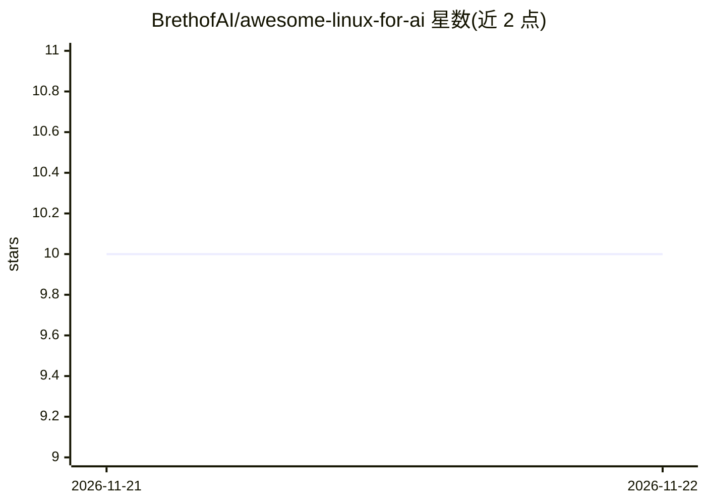

# BrethofAI/awesome-linux-for-ai

⭐ 10 · Python · MIT · 推送 2026-11-16 · [GitHub](https://github.com/BrethofAI/awesome-linux-for-ai) · [官网](https://brethof.ai/awesome/linux-for-ai/) · 个人维护

**面向本地 AI 工作站的 Linux 发行版分级清单**

由 Brethof AI 维护的精选分级清单（tier list），按 2026 年在自有硬件上运行本地 AI 的适配度对 Linux 发行版排名，评测维度包括 NVIDIA 驱动更新速度、CUDA/ROCm 安装体验、内核版本节奏、容器工具链支持与 btrfs 快照回滚能力。清单分 S/A/B/C 与 Snub Round 五档，收录 CachyOS、Arch、Pop!_OS、Fedora、Ubuntu、Debian 等 13 个发行版，并说明收录规则。该清单为其播客节目的文字参考版，内容含编辑立场。

## 筛选速览

| 维度 | 判定 | 备注 |
|---|---|---|
| AI 角色 | `ai-knowledge` | 知识聚合/清单类 |
| 许可风险 | `permissive` | MIT |
| 部署形态 | `None` |  |
| 模型依赖 | — | README 未给出锁定关系 |
| 硬件要求 | — | 无带数字的原话,不猜 |
| 安装摩擦 | `medium` | 含编译或系统依赖之一 |
| 成熟度 | — | 结构信号不足 |

## 能力要点

- 按 AI 工作站适配维度（驱动时效、CUDA 安装、快照回滚）分五档排名 13 个发行版
- 逐条列出各发行版 NVIDIA 驱动版本与内核版本的具体数据
- 包含明确的收录规则与档位图例说明

## 适用场景

- 为自己组装 AI 工作站时挑选 Linux 发行版
- 比较不同发行版安装 CUDA 与 NVIDIA 驱动的流程
- 了解各发行版驱动更新与内核节奏的差异

## 场景标签

`精选清单` · 领域:学习与行业

## 证据(README 行号)

> L3: > Curated tier list of Linux distros, ranked specifically for **running local AI on your own hardware in 2026** — NV
> L64: - **🟢 Tier S — Winner.** The one to install. Single entry: CachyOS.

## 星数曲线

2026-11-21 10 → 2026-11-22 10（+0）

---
*卡片 v1 · prompt 1.4 · 生成 2026-11-21 · 置信度 high · 依据 README sha `be110e2158cc` · [字段定义](../../DATASET.md)*
