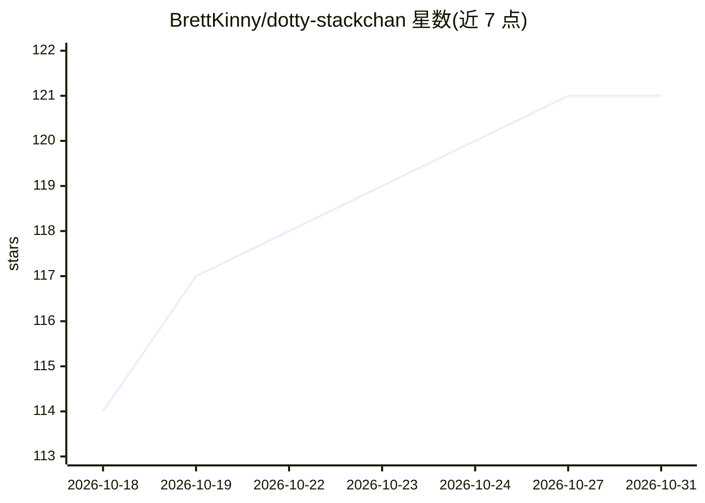

# BrettKinny/dotty-stackchan

⭐ 121 · Python · MIT · 推送 2026-10-29 · [GitHub](https://github.com/BrettKinny/dotty-stackchan) · [官网](https://www.youtube.com/@dotty-stackchan) · 个人维护 · 中文 README

**M5Stack StackChan 桌面机器人的全自托管语音助手栈**

面向 M5Stack StackChan 桌面机器人的自托管语音助手：开源固件跑在 ESP32-S3 设备上，服务器侧由 xiaozhi-esp32-server（语音 I/O）、pi agent 容器（大脑）、行为服务和管理面板四个 Docker 容器组成。ASR 默认 FunASR SenseVoiceSmall（GPU 主机自动切换 WhisperLocal），TTS 可选 Piper 离线或 EdgeTTS 云端；LLM 后端可插拔，推荐 llama-swap，可换 Ollama 或 OpenAI 兼容云端 API。默认开启儿童模式（人设引导 + 屏蔽词过滤，作者声明可绕过、不替代监护）。作者明确声明这是 hobby 级进行中项目，不稳定且回归频繁。

## 筛选速览

| 维度 | 判定 | 备注 |
|---|---|---|
| AI 角色 | `ai-native` | 本体是模型或模型工具 |
| 许可风险 | `permissive` | MIT |
| 部署形态 | `None` |  |
| 模型依赖 | local-ok | 支持本地模型 |
| 硬件要求 | — | 无带数字的原话,不猜 |
| 安装摩擦 | `low` | 无编译、无系统依赖或容器化 |
| 成熟度 | `idea` | |

## 能力要点

- ASR/TTS/会话状态全部本地运行，可路由到云端 LLM
- 默认 Kid Mode：人设 + 逐轮提示引导与屏蔽词过滤
- 硬件绑定隐私 LED（麦克风绿/摄像头红，RAII 保证）
- 六状态互斥机与 12 像素 LED 环状态显示

## 适用场景

- 给家里孩子搭建一个不把音频传出局域网的桌面语音机器人
- 在自有硬件上拥有可逐层理解、可替换各组件的语音助手
- 基于 StackChan 硬件做黑客式扩展（换 LLM/TTS/ASR/agent 框架）

## 场景标签

`语音 Agent` · 领域:对话与助手

## 证据(README 行号)

> L13: Dotty is a fully self-hosted voice stack for the M5Stack StackChan desktop robot. Open-source firmware on the robot
> L32: - **Local ASR** — FunASR SenseVoiceSmall by default, no cloud transcription. WhisperLocal auto-selects on GPU hosts

## 星数曲线

2026-10-18 114 → 2026-10-31 121（+7）

---
*卡片 v1 · prompt 1.4 · 生成 2026-10-23 · 置信度 high · 依据 README sha `ea80e673384b` · [字段定义](../../DATASET.md)*
