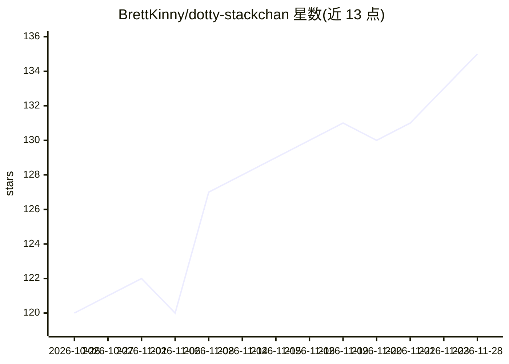

# BrettKinny/dotty-stackchan

⭐ 135 · Python · MIT · 推送 2026-11-13 · [GitHub](https://github.com/BrettKinny/dotty-stackchan) · [官网](https://www.youtube.com/@dotty-stackchan) · 个人维护

**自托管语音助手栈：让 M5Stack StackChan 桌面机器人本地运行对话**

面向 M5Stack StackChan 桌面机器人的自托管语音栈：开源固件运行在机器人上，xiaozhi-esp32-server 处理语音 I/O（ASR/TTS），本地 pi 编码 agent 作为大脑，LLM 可插拔，支持 llama-swap、Ollama 或任意 OpenAI 兼容 API。默认运行 Kid Mode，通过系统提示规则与屏蔽词过滤输出适龄回复，作者声明该过滤可被绕过。服务端四个组件以 Docker 容器运行于单台主机，附 Web 仪表盘。项目当前因作者硬件电源问题暂停开发，作者声明仅在自有机器人上端到端验证过。

## 筛选速览

| 维度 | 判定 | 备注 |
|---|---|---|
| AI 角色 | `ai-native` | 本体是模型或模型工具 |
| 许可风险 | `permissive` | MIT |
| 部署形态 | `None` |  |
| 模型依赖 | local-ok | 支持本地模型 |
| 硬件要求 | — | 无带数字的原话,不猜 |
| 安装摩擦 | `low` | 无编译、无系统依赖或容器化 |
| 成熟度 | — | 结构信号不足 |

## 能力要点

- ASR/TTS/会话状态全部在自有硬件上运行，云端 LLM 调用可通过配置切换为本地模型
- 默认 Kid Mode：系统提示规则加屏蔽词过滤替换不匹配的语音回复
- 六个状态（idle/talk/story_time/security/sleep/dance）由固件 StateManager 管理，12 像素 LED 环显示
- 语音流式回复：模型输出逐句进入 TTS，回复未生成完毕即开始说话

## 适用场景

- 为孩子搭建一个不依赖云服务的桌面语音机器人
- 本地化托管家庭麦克风/摄像头语音助手以控制数据流向
- 作为自托管 StackChan 助手项目的起始模板

## 场景标签

`语音 Agent` · 领域:对话与助手

## 证据(README 行号)

> L16: Dotty is a fully self-hosted voice stack for the M5Stack StackChan desktop robot. Open-source firmware runs on the 
> L18: Out of the box, Dotty runs in **Kid Mode**. The persona and the Kid Mode rules in pi's system prompt steer replies 
> L14: > **Status:** a hobby project with one maintainer, built with heavy AI assistance (AI_TRANSPARENCY.md). It runs end

## 星数曲线

2026-10-26 120 → 2026-11-28 135（+15）

---
*卡片 v1 · prompt 1.4 · 生成 2026-11-28 · 置信度 high · 依据 README sha `f5760cfce3bc` · [字段定义](../../DATASET.md)*
