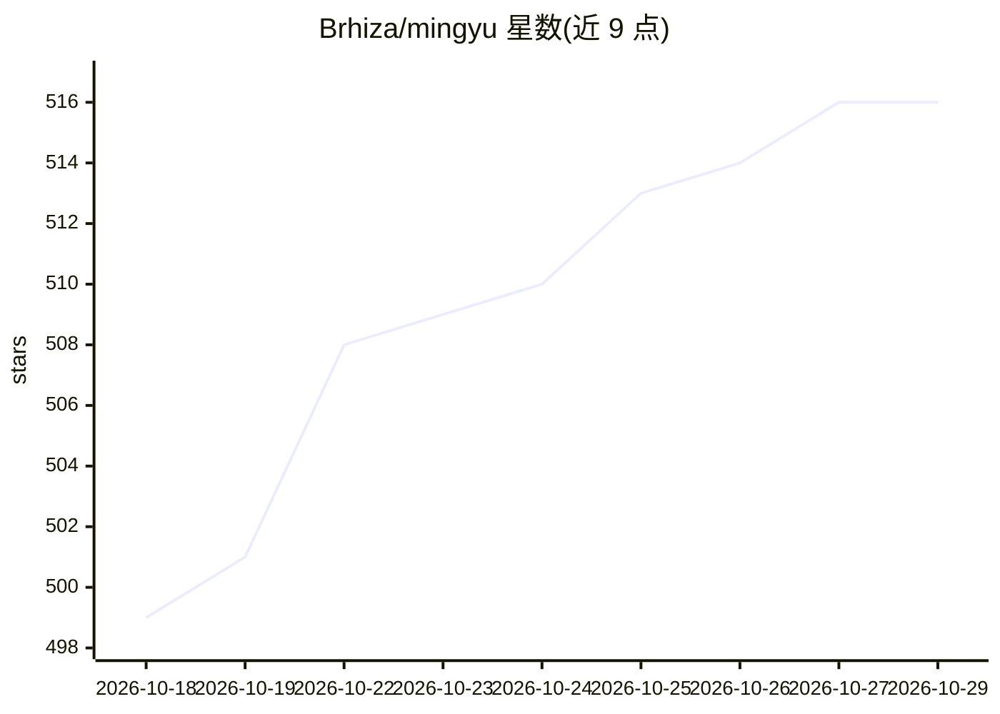

# Brhiza/mingyu

⭐ 516 · TypeScript · AGPL-3.0 · 推送 2026-10-26 · [GitHub](https://github.com/Brhiza/mingyu) · [官网](https://aov.cc) · 个人维护 · 中文 README

**面向 AI 的玄学排盘工具包：输出结构化命盘与解读提示词**

覆盖八字、紫微、星盘、六爻、梅花、奇门、大六壬、塔罗、雷诺曼、灵签、择日等术数的排盘计算工具包。核心机制是完成排盘计算后生成可直接交给任意大模型解读的提示词与结构化数据，而非自身产出解读。提供 npm 核心包 mingyu-core、公开 REST API（https://aov.cc/api/v1）、本地/远程 MCP Server、Agent Skill 与 Android 原生应用（可唤起已装 AI 应用对话，API Key 仅存本地）。个人业余维护，AGPL-3.0-only 开源，在线服务受 Cloudflare 配额与请求体限制。

## 筛选速览

| 维度 | 判定 | 备注 |
|---|---|---|
| AI 角色 | `ai-ecosystem` | LLM/agent 周边工具 |
| 许可风险 | `viral` | AGPL-3.0 |
| 部署形态 | `library` | 以包/库形式分发 |
| 模型依赖 | — | README 未给出锁定关系 |
| 硬件要求 | — | 无带数字的原话,不猜 |
| 安装摩擦 | `low` | 无编译、无系统依赖或容器化 |
| 成熟度 | — | 结构信号不足 |

## 能力要点

- 20+ 种术数方法的排盘计算与结构化输出
- 生成可直接交给任意大模型解读的提示词（/prompt 端点）
- npm 包 mingyu-core、REST API、MCP Server（stdio 与 Streamable HTTP）、Agent Skill 四种接入方式
- Android 原生应用支持排盘后一键唤起已安装 AI 应用对话

## 适用场景

- 为我的 AI 助手接入八字、六爻、塔罗等排盘与解读能力
- 在 Cursor/Claude Desktop 等客户端通过 MCP 直接起卦排盘
- 在自有产品中通过 mingyu-core 或 REST API 集成术数排盘

## 场景标签

 · 领域:玄学占卜/传统文化工具

## 证据(README 行号)

> L3: 命语是一套免费开源的在线算命、占卜排盘与 AI 解读提示词工具。输入出生时间或所问之事，即可完成高精度排盘，并生成可直接交给任意大模型解读的完整提示词。
> L63: - 要把资料交给 AI 解读时，只调用一次对应的 `/prompt`；服务端会同时完成排盘并返回任务书。只有需要展示或继续计算结构化盘面时才调用 `/calculate`。

## 星数曲线

2026-10-18 499 → 2026-10-29 516（+17）

---
*卡片 v1 · prompt 1.4 · 生成 2026-10-21 · 置信度 high · 依据 README sha `2f6c7c633d00` · [字段定义](../../DATASET.md)*
