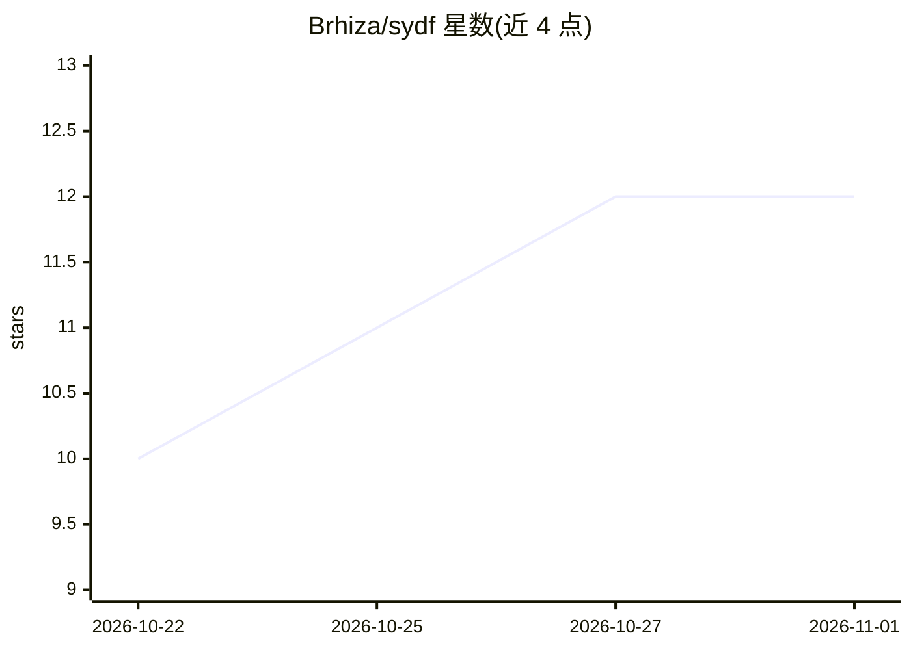

# Brhiza/sydf

⭐ 12 · TypeScript · 推送 2026-09-10 · [GitHub](https://github.com/Brhiza/sydf) · [官网](https://sydf.cc) · 个人维护 · 中文 README

**面向普通用户的东方术数与西方占卜 Web 应用，带 AI 解读**

Vue 3 + TypeScript 构建的 PWA，功能覆盖梅花易数、六爻、奇门遁甲等东方术数排盘，塔罗、雷诺曼等西方占卜，八字/紫微/星盘命盘与合盘，黄历、起名、诸葛神数等日常工具。AI 解读支持内置服务端接口（OpenAI 兼容，chat/responses/anthropic 三种类型）、自定义接口与服务不可用时复制提示词；算法能力来自并行维护的 mingyu-core。数据存于浏览器本地，部署到 Cloudflare Pages，另可用 Capacitor 打包 Android APK。

## 筛选速览

| 维度 | 判定 | 备注 |
|---|---|---|
| AI 角色 | `ai-native` | 本体是模型或模型工具 |
| 许可风险 | `none` | — |
| 部署形态 | `library` | 以包/库形式分发 |
| 模型依赖 | — | README 未给出锁定关系 |
| 硬件要求 | — | 无带数字的原话,不猜 |
| 安装摩擦 | `low` | 无编译、无系统依赖或容器化 |
| 成熟度 | — | 结构信号不足 |

## 能力要点

- 覆盖东方术数、西方占卜、命盘合盘与传统日历的完整功能集
- AI 解读支持内置接口、自定义兼容接口与提示词复制离线使用
- 未配置 AI 时排盘与占卜功能仍可使用
- Cloudflare Pages 部署，PWA 离线缓存与 Capacitor Android APK

## 适用场景

- 日常查运势、黄历、每日一卦与起名测字
- 进行塔罗、六爻等占卜并获取 AI 解读
- 排八字、紫微、星盘命盘并做双人合盘
- 以 PWA 或 Android APK 形式在移动端离线使用

## 场景标签

 · 领域:文化/占卜应用

## 证据(README 行号)

> L15: 时月东方是一款面向普通用户的术数、占卜与 AI 解读应用。项目将传统排盘、东西方占卜、日历与现代交互结合，尽量用直观的页面和现代语言呈现复杂结果，同时保留可供深入查看的专业资料。
> L27: - AI 解读：支持内置 AI、自定义兼容接口、后台解读、历史记录，以及服务不可用时复制提示词到其他 AI。

## 星数曲线

2026-10-22 10 → 2026-11-01 12（+2）

---
*卡片 v1 · prompt 1.4 · 生成 2026-11-01 · 置信度 mid · 依据 README sha `7c912cddfd02` · [字段定义](../../DATASET.md)*
