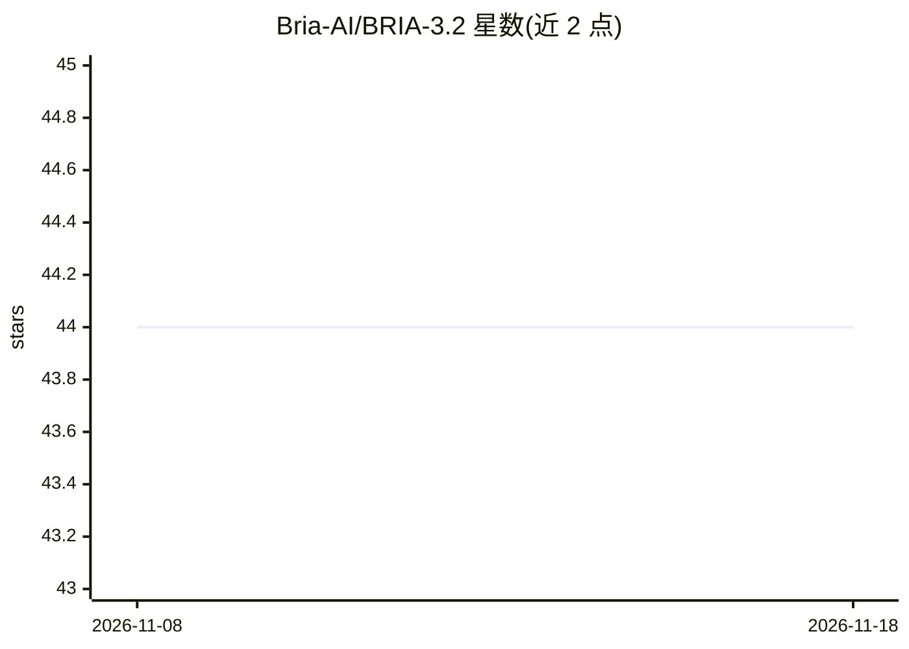

# Bria-AI/BRIA-3.2

⭐ 44 · NOASSERTION · 推送 2026-11-03 · [GitHub](https://github.com/Bria-AI/BRIA-3.2) · [官网](https://bria.ai/) · 组织维护

**面向商用的 4B 参数文生图模型（BRIA 3.2 权重与管线）**

BRIA AI 发布的 4B 参数 rectified flow transformer 文生图模型，使用 T5 文本编码器，基于 100% 授权数据训练，主打企业商用场景下的版权合规与法律责任覆盖。生成短文本（1-6 词）渲染经优化，支持多宽高比（总像素约 1M）。获取方式包括 API（Bria.ai、Fal.ai、Replicate）、ComfyUI 节点，以及需购买商业许可的源码与权重；可通过 Diffusers 管线运行，推荐 Nvidia L40S 及以上 GPU，另有面向初创/学生的免费申请通道。

## 筛选速览

| 维度 | 判定 | 备注 |
|---|---|---|
| AI 角色 | `ai-native` | 本体是模型或模型工具 |
| 许可风险 | `none` | NOASSERTION |
| 部署形态 | `library` | 以包/库形式分发 |
| 模型依赖 | — | README 未给出锁定关系 |
| 硬件要求 | — | 无带数字的原话,不猜 |
| 安装摩擦 | `low` | 无编译、无系统依赖或容器化 |
| 成熟度 | — | 结构信号不足 |

## 能力要点

- 4B 参数 rectified flow transformer + T5 文本编码器
- 基于 100% 授权数据训练，附法律责任覆盖与专利署名引擎
- 短文本渲染优化，支持多宽高比（约 1M 像素总量）
- 提供 API 端点、ComfyUI 节点与可购许可的源码/权重三种接入方式

## 适用场景

- 企业商用场景下生成版权合规的图像内容
- 通过 Diffusers 或 ComfyUI 工作流本地/自托管生成图像
- 按品牌需求对源码和权重做定制微调

## 场景标签

`图像生成` · 领域:内容生成

## 证据(README 行号)

> L21: Bria 3.2 is the next-generation commercial-ready text-to-image model.
> L79: - **Model type:** Latent diffusion text-to-image model
> L89: ```python

## 星数曲线



2026-11-08 44 → 2026-11-18 44（+0）


---
*卡片 v1 · prompt 1.4 · 生成 2026-11-18 · 置信度 mid · 依据 README sha `ccf442b85272` · [字段定义](../../DATASET.md)*
