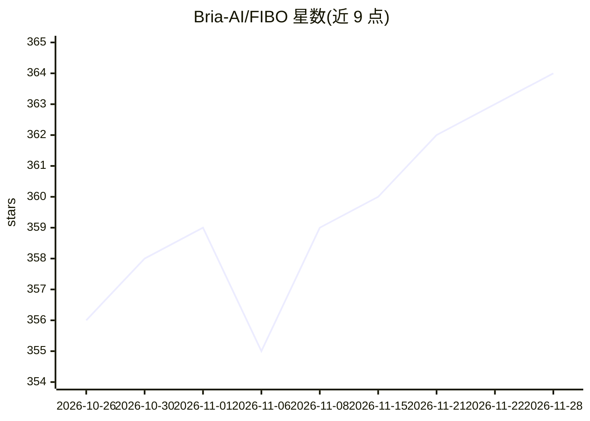

# Bria-AI/FIBO

⭐ 364 · Python · NOASSERTION · 推送 2026-11-24 · [GitHub](https://github.com/Bria-AI/FIBO) · [官网](https://bria.ai) · 组织维护

**面向专业工作流的 JSON 原生开源文生图模型**

Bria AI 发布的 8B 参数开源文生图模型，仅以长结构化 JSON 字幕（1000+ 词）训练，围绕可控性与可复现性设计。提供三种模式：Generate（VLM 将短提示扩展为结构化 JSON 后生成）、Refine（仅更新指定属性进行迭代）、Inspire（从输入图像提取结构化提示生成变体）。Fibo 2.0 Dev 统一文生图与图像编辑（掩码编辑、多参考图）。提供本地推理脚本、ComfyUI 节点与 Bria/Fal.ai/Replicate API 端点；权重仅限非商业用途，商业用途需另行授权。

## 筛选速览

| 维度 | 判定 | 备注 |
|---|---|---|
| AI 角色 | `ai-native` | 本体是模型或模型工具 |
| 许可风险 | `none` | NOASSERTION |
| 部署形态 | `None` |  |
| 模型依赖 | — | README 未给出锁定关系 |
| 硬件要求 | — | 无带数字的原话,不猜 |
| 安装摩擦 | `medium` | 含编译或系统依赖之一 |
| 成熟度 | `idea` | |

## 能力要点

- JSON 原生结构化提示，支持解耦的单属性微调
- Generate/Refine/Inspire 三种生成模式与图像编辑（掩码、最多 4 张参考图）
- VLM 后端可选 Gemini API 或本地 FIBO-VLM（--model-mode local）
- TeaCache 加速生成 3 倍，另有 ComfyUI 节点与三家 API 端点

## 适用场景

- 需要精确控制光照、构图、相机参数的专业图像生成
- 基于结构化提示做迭代式属性级修图
- 从参考图提取结构化提示生成相关变体

## 场景标签

`图像生成` · 领域:内容生成

## 证据(README 行号)

> L48:  FIBO is the first open-source, JSON-native text-to-image model trained exclusively on long structured captions.
> L53:  Most text-to-image models excel at imagination—but not control. FIBO is built for professional workflows, not casu
> L102:  The model is open source for non-commercial use with this license

## 星数曲线

2026-10-26 356 → 2026-11-28 364（+8）

---
*卡片 v1 · prompt 1.4 · 生成 2026-11-26 · 置信度 high · 依据 README sha `9eaa8a6d53c7` · [字段定义](../../DATASET.md)*
