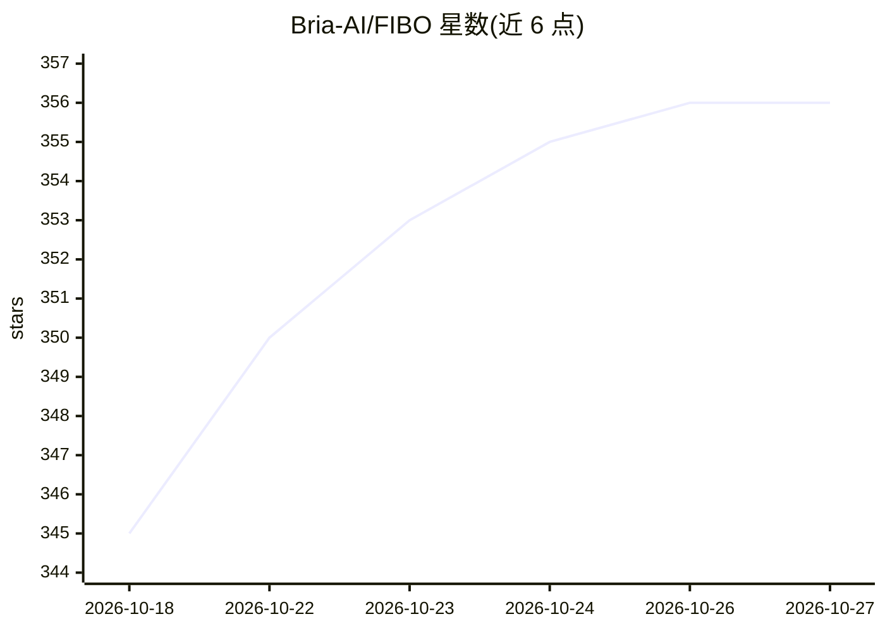

# Bria-AI/FIBO

⭐ 356 · Python · NOASSERTION · 推送 2026-10-06 · [GitHub](https://github.com/Bria-AI/FIBO) · [官网](https://bria.ai) · 组织维护

**8B 参数 JSON 原生文生图模型，支持可控迭代生成**

Bria 开源的 8B 参数 DiT 架构文生图模型，基于流匹配训练，使用 SmolLM3-3B 文本编码器与 Wan 2.2 VAE。其特点是以约 1000 词的结构化 JSON 长描述训练，支持 Generate/Refine/Inspire 三种模式：短提示经 VLM 扩展为结构化 JSON 后生成图像、按指令迭代精修、从图像提取提示再生成。训练数据全部来自授权数据集。许可为非商业用途开源，商业使用需另行获取授权；可通过源码本地运行、ComfyUI 节点或 Bria/Fal.ai/Replicate API 使用。

## 筛选速览

| 维度 | 判定 | 备注 |
|---|---|---|
| AI 角色 | `ai-native` | 本体是模型或模型工具 |
| 许可风险 | `none` | NOASSERTION |
| 部署形态 | `None` |  |
| 模型依赖 | — | README 未给出锁定关系 |
| 硬件要求 | — | 无带数字的原话,不猜 |
| 安装摩擦 | `medium` | 含编译或系统依赖之一 |
| 成熟度 | — | 结构信号不足 |

## 能力要点

- 结构化 JSON 长描述训练，支持属性级解耦控制与迭代精修
- Generate/Refine/Inspire 三种模式，VLM 可用 Gemini 或本地 FIBO-VLM
- TeaCache 加速选项（生成提速约 3 倍）
- 提供微调代码、ComfyUI 节点与 API 端点多种接入方式

## 适用场景

- 需要精确控制光照、构图、相机参数的专业图像生成
- 对图像局部属性做迭代精修而不破坏整体场景
- 从参考图像提取结构化提示生成变体获取灵感
- 有合规数据要求的商业生产环境（需商业授权）

## 场景标签

`图像生成` `微调` · 领域:内容生成

## 证据(README 行号)

> L48:  FIBO is the first open-source, JSON-native text-to-image model trained exclusively on long structured captions.
> L227:  FIBO is an 8B-parameter DiT-based, flow-matching text-to-image model trained exclusively on licensed data and on 

## 星数曲线

2026-10-18 345 → 2026-10-27 356（+11）

---
*卡片 v1 · prompt 1.4 · 生成 2026-10-21 · 置信度 high · 依据 README sha `db49767e8fbb` · [字段定义](../../DATASET.md)*
