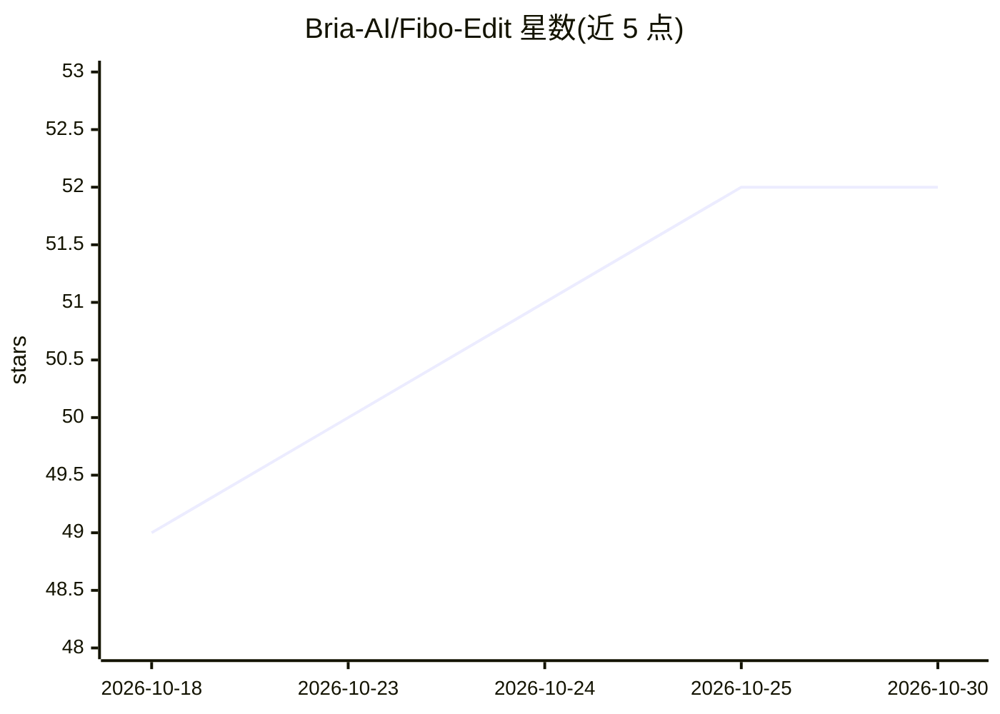

# Bria-AI/Fibo-Edit

⭐ 52 · Python · 推送 2026-10-06 · [GitHub](https://github.com/Bria-AI/Fibo-Edit) · [官网](https://bria.ai) · 组织维护

**面向专业生产的结构化 JSON 控制图像编辑模型**

Bria AI 开发的 8B 参数图像编辑模型（含 base 与蒸馏到 4 步的 turbo 版本），以结构化 JSON（VGL 范式）替代自然语言提示词，配合源图与可选掩码执行确定性编辑，支持多参考图合成、掩码局部编辑与 LoRA 微调。结构化提示词生成有两种模式：默认经 Gemini API，或用本地 VLM 模型在自有 GPU 上运行（不支持掩码与多参考）。模型权重以非商业许可开源，商用需另行获取许可；训练数据为获得完全授权的数据。

## 筛选速览

| 维度 | 判定 | 备注 |
|---|---|---|
| AI 角色 | `ai-native` | 本体是模型或模型工具 |
| 许可风险 | `none` | — |
| 部署形态 | `None` |  |
| 模型依赖 | — | README 未给出锁定关系 |
| 硬件要求 | — | 无带数字的原话,不猜 |
| 安装摩擦 | `medium` | 含编译或系统依赖之一 |
| 成熟度 | — | 结构信号不足 |

## 能力要点

- JSON 结构化控制编辑（光照/构图/风格等显式参数）
- 原生掩码编辑与多参考图合成
- turbo 版本蒸馏至 4 步推理
- LoRA 微调支持（base 版本）与 Diffusers 集成

## 适用场景

- 商业图像生产管线中做精确可控的图像编辑
- 研究人员针对特定领域微调专属编辑模型
- 通过 Hugging Face Demo 或 API 端点快速试用

## 场景标签

`图像生成` · 领域:内容生成

## 证据(README 行号)

> L42:  FIBO-Edit brings the power of structured prompt generation to image editing.
> L67:  Production-Ready Architecture : At 8B parameters, the model balances high-fidelity output with the speed and effic

## 星数曲线

2026-10-18 49 → 2026-10-30 52（+3）

---
*卡片 v1 · prompt 1.4 · 生成 2026-10-24 · 置信度 high · 依据 README sha `88e787f6be8a` · [字段定义](../../DATASET.md)*
