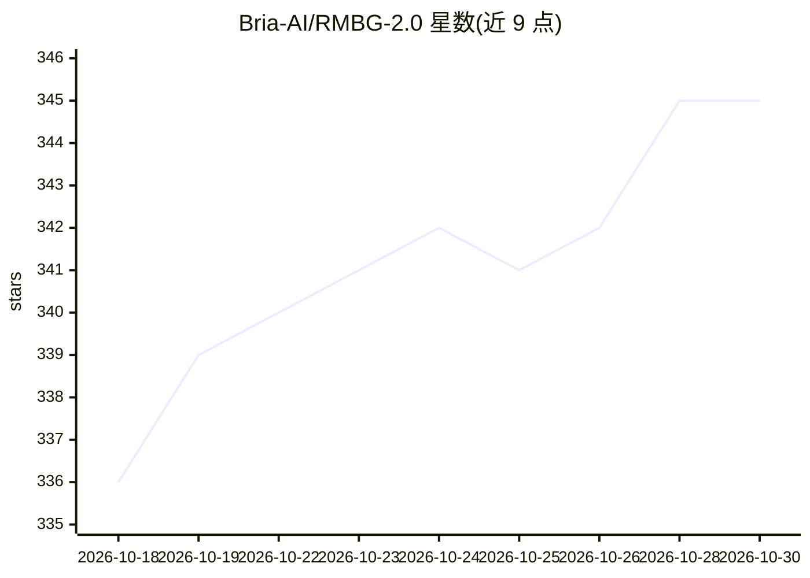

# Bria-AI/RMBG-2.0

⭐ 345 · Python · NOASSERTION · 推送 2025-12-11 · [GitHub](https://github.com/Bria-AI/RMBG-2.0) · [官网](https://bria.ai/) · 组织维护

**面向商用的图像背景去除分割模型，输出灰度 alpha 蒙版**

BRIA AI 开发的二分图像分割模型 RMBG-2.0，基于 BiRefNet 架构，用于将前景与背景分离并输出单通道 8 位灰度 alpha 蒙版，开发者可自定义阈值做前景/背景切分。训练数据为超过 15,000 张获得授权、像素级人工标注的高分辨率图像，覆盖电商、游戏、广告等类别。模型以 CC BY-NC 4.0 许可用于非商业用途，商业使用需向 BRIA 购买许可；另提供 ComfyUI 节点与 API 端点（Bria.ai、fal.ai、Replicate）。运行依赖 torch、torchvision、pillow、kornia、transformers。

## 筛选速览

| 维度 | 判定 | 备注 |
|---|---|---|
| AI 角色 | `ai-native` | 本体是模型或模型工具 |
| 许可风险 | `none` | NOASSERTION |
| 部署形态 | `None` |  |
| 模型依赖 | — | README 未给出锁定关系 |
| 硬件要求 | — | 无带数字的原话,不猜 |
| 安装摩擦 | `low` | 无编译、无系统依赖或容器化 |
| 成熟度 | — | 结构信号不足 |

## 能力要点

- 基于 BiRefNet 架构的二分图像分割，输出灰度 alpha 蒙版而非二值掩码
- 训练数据含 15,000+ 张全授权、像素级人工标注图像
- 提供 HuggingFace 模型权重与在线 Demo Space
- 以 ComfyUI 节点和 API 端点形式分发

## 适用场景

- 电商与广告图片批量去除背景
- 在企业内容生产流水线中生成前景蒙版
- 在 ComfyUI 工作流中做背景去除

## 场景标签

`图像视频处理` · 领域:感知与多模态

## 证据(README 行号)

> L15: RMBG v2.0 is our new state-of-the-art background removal model significantly improves RMBG v1.4. The model is desig
> L51: - **Model Description:** BRIA RMBG-2.0 is a dichotomous image segmentation model trained exclusively on a professio
> L91: RMBG-2.0 is developed on the BiRefNet architecture enhanced with our proprietary dataset and training scheme. This 

## 星数曲线

2026-10-18 336 → 2026-10-30 345（+9）

---
*卡片 v1 · prompt 1.4 · 生成 2026-10-21 · 置信度 high · 依据 README sha `0c0ec4d79691` · [字段定义](../../DATASET.md)*
