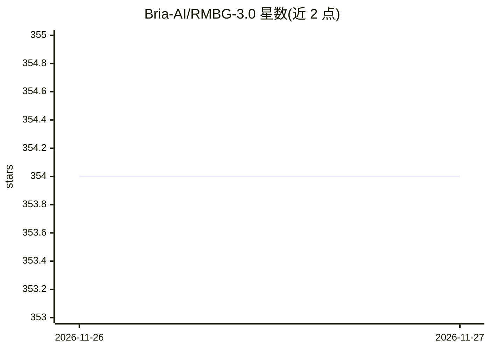

# Bria-AI/RMBG-3.0

⭐ 354 · Python · NOASSERTION · 推送 2026-11-24 · [GitHub](https://github.com/Bria-AI/RMBG-3.0) · [官网](https://bria.ai/) · 组织维护

**给开发者提供图像背景移除模型（RMBG-3.0/2.0）的本地运行脚本**

包含 Bria 两个背景移除模型的使用仓库：RMBG-3.0 基于 Fibo 2.0 生成式基座（8B 参数，4 步蒸馏，输出 alpha matte），RMBG-2.0 为 BiRefNet 分割模型（0.2B 参数，适合高吞吐与边缘设备）。仓库提供 remove_bg.py 命令行脚本，从带 alpha 通道的原图写出 cutout PNG；权重托管于 Hugging Face 且为 gated，需先接受访问表单再 hf auth login。两模型均以 CC BY-NC 4.0 发布，商业使用需向 Bria 购买许可或调用其 API/fal/Replicate 端点。RMBG-3.0 需 32GB 以上 CUDA GPU。

## 筛选速览

| 维度 | 判定 | 备注 |
|---|---|---|
| AI 角色 | `ai-native` | 本体是模型或模型工具 |
| 许可风险 | `none` | NOASSERTION |
| 部署形态 | `library` | 以包/库形式分发 |
| 模型依赖 | — | README 未给出锁定关系 |
| 硬件要求 | `gpu-24g` | |
| 安装摩擦 | `medium` | 含编译或系统依赖之一 |
| 成熟度 | — | 结构信号不足 |

## 能力要点

- 两个模型覆盖质量优先（3.0，生成式）与速度优先（2.0，分割）两条路径
- remove_bg.py 命令行一次加载模型批量处理多图，支持 --device cuda/mps/cpu
- 输出单通道 8 位 alpha matte，可直接作 alpha 通道或二值化
- 提供 Hugging Face Space demo 与 Bria/fal/Replicate API 端点

## 适用场景

- 为电商商品图批量生成透明背景 cutout
- 在无法满足大显存时用 RMBG-2.0 在小 GPU 或边缘设备上跑分割
- 通过 Bria API 无 GPU 调用背景移除服务

## 场景标签

`图像视频处理` · 领域:感知与多模态

## 证据(README 行号)

> L20: This repository covers Bria's two current background removal models. Both are trained exclusively on licensed data
> L24: - **RMBG-3.0** is the newest model and the first one built on a generative foundation (Fibo 2.0). It gives the best
> L116: - **Model type:** Background Removal

## 星数曲线

2026-11-26 354 → 2026-11-27 354（+0）

---
*卡片 v1 · prompt 1.4 · 生成 2026-11-26 · 置信度 high · 依据 README sha `8610d0a9fe68` · [字段定义](../../DATASET.md)*
