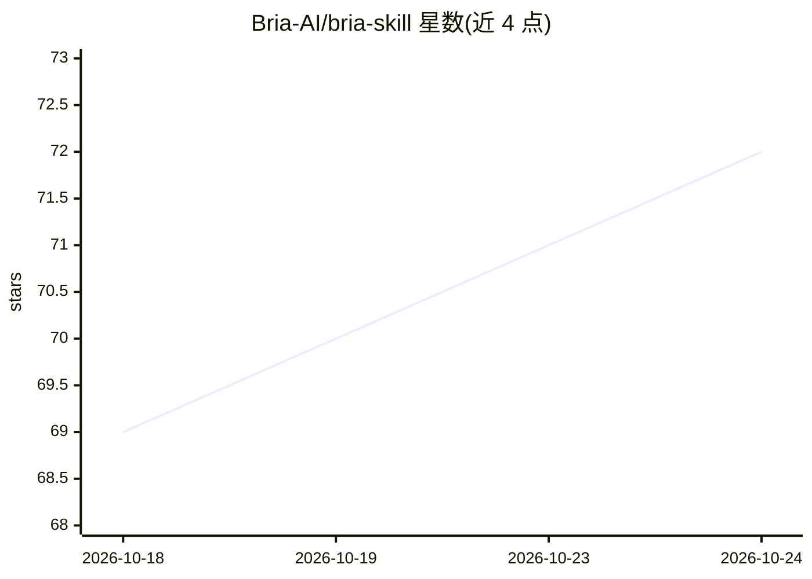

# Bria-AI/bria-skill

⭐ 72 · Python · 推送 2026-10-21 · [GitHub](https://github.com/Bria-AI/bria-skill) · 组织维护

**让编程 Agent 调用 Bria 图像生成/编辑能力的技能包**

面向 Claude Code、Cursor、Cline、Codex 等 40 余种编码 Agent 的技能集合，通过 Bria.ai 的 API 提供可控图像生成与编辑：文生图、对象级编辑、蒙版修改、背景移除（RMBG 2.0）、重打光、风格/季节控制、扩图、超分与流水线串联等 18+ 能力，另含 VGL 结构化 JSON 生成、广告图层拆解、广告多尺寸重排和基于 Pillow 的常规图像处理技能。需注册获取 Bria API key（免费），支持插件市场、npx、MCP 或手动复制 skills 目录安装。

## 筛选速览

| 维度 | 判定 | 备注 |
|---|---|---|
| AI 角色 | `ai-ecosystem` | LLM/agent 周边工具 |
| 许可风险 | `none` | — |
| 部署形态 | `library` | 以包/库形式分发 |
| 模型依赖 | — | README 未给出锁定关系 |
| 硬件要求 | — | 无带数字的原话,不猜 |
| 安装摩擦 | `low` | 无编译、无系统依赖或容器化 |
| 成熟度 | — | 结构信号不足 |

## 能力要点

- 18+ 可控图像能力：对象级编辑、蒙版修改、独立控制光照/风格/季节
- VGL 结构化 JSON 定义物体、光照、相机、构图与风格
- 6 个技能：bria-ai、remove-background、vgl、ad-delayer、ad-resize、image-utils
- 兼容 Claude Code、Cursor、Cline、Codex 等 37+ Agent，支持流水线链式操作

## 适用场景

- 让编码 Agent 直接生成网页 hero 图与幻灯片视觉素材
- 电商场景：批量产品图去背景并合成到指定场景
- 广告设计：将成图拆回可编辑图层并按各投放尺寸重排

## 场景标签

`图像生成` `图像视频处理` · 领域:内容生成

## 证据(README 行号)

> L1: # Bria AI Skills — Controllable Image Generation for Coding Agents
> L5: **Works with:** Claude Code, Cursor, Cline, Codex, and 37+ other agents
> L40: Ask your agent to generate images, remove backgrounds, edit photos, and more. The skill handles the rest.

## 星数曲线

2026-10-18 69 → 2026-10-24 72（+3）

---
*卡片 v1 · prompt 1.4 · 生成 2026-10-24 · 置信度 mid · 依据 README sha `67921531f646` · [字段定义](../../DATASET.md)*
