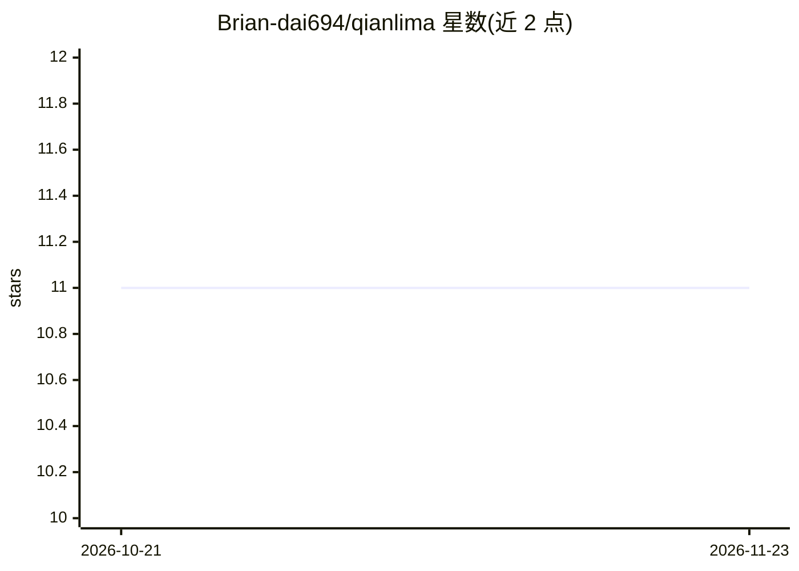

# Brian-dai694/qianlima

⭐ 11 · PowerShell · MIT · 推送 2026-07-27 · [GitHub](https://github.com/Brian-dai694/qianlima) · 个人维护 · 中文 README

**面向个人用户的本地任务 Agent Harness，以任务闭环组织 AI 执行**

本地优先、可恢复、可验证的个人任务 Harness：将任务围绕 task_id 组织为路由、最小上下文、受限工具执行、证据验证与回执记录的闭环。Codex、Claude Code 负责交互与推理，本系统负责任务路由、业务口径、记忆分层（hot/warm/cold）、权限边界与结果核验。核心场景为 Amazon 运营（广告诊断、Listing、选品、库存等），附带低风险自进化机制与 Governed Loop 写检分离设计。提供 Windows/macOS/Linux 启动脚本；MCP 仅预留本地 stdio 模式。

## 筛选速览

| 维度 | 判定 | 备注 |
|---|---|---|
| AI 角色 | `ai-ecosystem` | LLM/agent 周边工具 |
| 许可风险 | `permissive` | MIT |
| 部署形态 | `None` |  |
| 模型依赖 | — | README 未给出锁定关系 |
| 硬件要求 | — | 无带数字的原话,不猜 |
| 安装摩擦 | `low` | 无编译、无系统依赖或容器化 |
| 成熟度 | — | 结构信号不足 |

## 能力要点

- 任务以 task_id 组织为可恢复、可验证的执行闭环
- 记忆按 hot/warm/cold 分层，先过滤再召回
- 自进化采用 Builder/Checker 写检分离，最多 5 轮，越权自动冻结
- 广告异常诊断闭环：本地 CSV 输入，输出结构化行动卡与证据回执

## 适用场景

- 本地分析 Amazon 广告数据并生成可回滚的行动建议
- 让 Agent 在受限权限下执行报表、文件整理等日常任务
- 为个人任务沉淀可版本化的 Skill 方法卡

## 场景标签

`AI 助手` `工作流自动化` `数据分析` · 领域:效率与自动化

## 证据(README 行号)

> L5: 本地优先、可恢复、可验证的个人任务 Agent Harness。Amazon 运营是其中一个场景包，而不是系统的全部定位。
> L22: Codex、Claude Code 等负责交互和推理；千里马负责任务路由、业务口径、记忆选择、权限边界、执行回执和结果核验。

## 星数曲线

2026-10-21 11 → 2026-11-23 11（+0）

---
*卡片 v1 · prompt 1.4 · 生成 2026-11-19 · 置信度 high · 依据 README sha `c9306e3b9fa4` · [字段定义](../../DATASET.md)*
