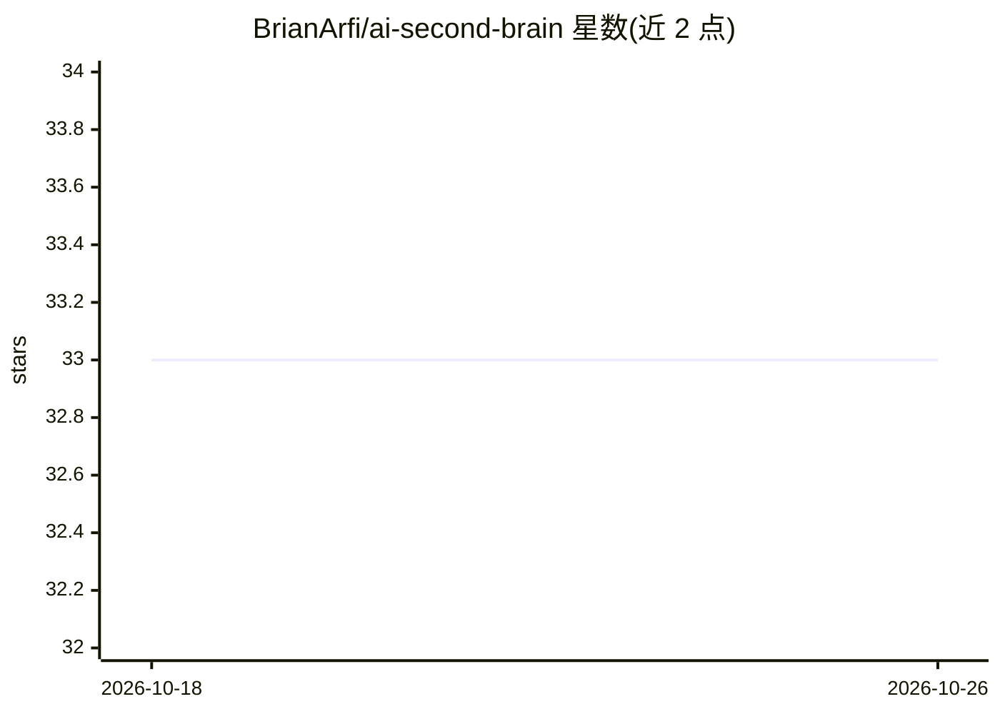

# BrianArfi/ai-second-brain

⭐ 33 · Python · Apache-2.0 · 推送 2026-10-20 · [GitHub](https://github.com/BrianArfi/ai-second-brain) · 个人维护

**个人 AI 工作操作系统：为知识工作者起草会议纪要与周报并学习修正**

运行在 Claude Code 中的个人工作空间模板：通过 CLAUDE.md 保存用户角色与规则，从日历、Slack、Gmail、会议记录等来源读取上下文，用斜杠命令或自然语言生成晨间计划、会议纪要、周报和待回复草稿，所有输出需用户批准后发送；子代理并行读取并在评审后再出稿，/learn 将修正保存为规则。带本地仪表盘（localhost:3737，纯 Python 标准库）。需 Claude Code（付费 Claude 计划）、git、Node.js 18+，Python 3 用于连接器与仪表盘。单机单人工作区，不托管。

## 筛选速览

| 维度 | 判定 | 备注 |
|---|---|---|
| AI 角色 | `ai-native` | 本体是模型或模型工具 |
| 许可风险 | `permissive` | Apache-2.0 |
| 部署形态 | `library` | 以包/库形式分发 |
| 模型依赖 | locked-api |  |
| 硬件要求 | — | 无带数字的原话,不猜 |
| 安装摩擦 | `low` | 无编译、无系统依赖或容器化 |
| 成熟度 | — | 结构信号不足 |

## 能力要点

- 读取日历/Slack/Gmail/Jira 等真实工具生成周报、纪要与回复草稿，发送前需人工批准
- /learn 机制将一次性修正保存为规则，跨会话生效
- 本地仪表盘（Today/Inbox/Work 等标签页），纯 Python 标准库实现
- 本机会议录制与转录（macOS/Windows/Linux）

## 适用场景

- 每周固定产出周报、会议纪要和跟进回复的 PM 或团队负责人
- 把散落在多处的工作上下文集中到一个经批准后执行的个人助理
- 让 AI 记住并复用自己每周的文档写作规则

## 场景标签

`AI 助手` `AI 写作` · 领域:对话与助手

## 证据(README 行号)

> L5: Your morning plan, meeting minutes, weekly report and every reply you owe, drafted from your own calendar, Slack, em
> L7: For PMs, team leads and founders whose week runs on meetings, Slack and Google Docs. Free and open source. You need 

## 星数曲线

2026-10-18 33 → 2026-10-26 33（+0）

---
*卡片 v1 · prompt 1.4 · 生成 2026-10-25 · 置信度 mid · 依据 README sha `d8f27b2b621e` · [字段定义](../../DATASET.md)*
