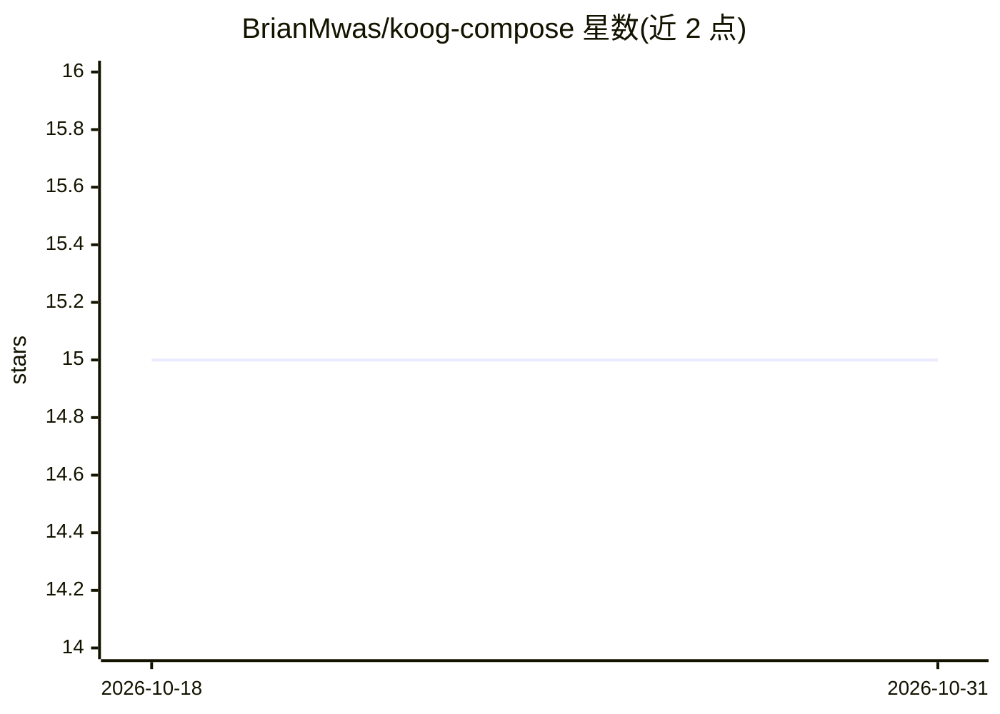

# BrianMwas/koog-compose

⭐ 15 · Kotlin · 推送 2026-08-24 · [GitHub](https://github.com/BrianMwas/koog-compose) · 个人维护

**Kotlin Multiplatform 库：在 Compose 中构建端上 AI agent**

构建在 JetBrains Koog 之上的 Kotlin Multiplatform 库，面向移动/桌面应用开发者。提供单一 koogCompose DSL 管理 LLM 会话、多步 phase 流转（含子阶段与并行分支）、设备工具（GPS/闹钟/屏幕时间等，经参数校验、限流、确认 UI 的管道）、流式 token 输出到 Compose UI，以及 agent 驱动的声明式 UI 布局引擎。支持 OpenAI、本地 Ollama、Android 端上 Gemma 4（LiteRT-LM）与 iOS Apple Foundation Models，默认端上推理无需网络。依赖 Kotlin 2.3.20 与 Koog 1.0.0，iOS 需 iOS 26+ 才能用 Apple FMs，桌面端上推理为规划中。

## 筛选速览

| 维度 | 判定 | 备注 |
|---|---|---|
| AI 角色 | `ai-ecosystem` | LLM/agent 周边工具 |
| 许可风险 | `none` | — |
| 部署形态 | `None` |  |
| 模型依赖 | local-ok | 支持本地模型 |
| 硬件要求 | — | 无带数字的原话,不猜 |
| 安装摩擦 | `low` | 无编译、无系统依赖或容器化 |
| 成熟度 | — | 结构信号不足 |

## 能力要点

- 单一 koogCompose DSL 覆盖会话、设备工具、phase 流与流式 UI
- 工具调用管道：validateArgs → 限流/白名单 → 三级确认 UI（SAFE/SENSITIVE/CRITICAL）
- 端上推理：Android 走 LiteRT-LM Gemma 4，iOS 走 Apple Foundation Models，默认无 API key 无网络
- agent 发布局指令（Show/Hide/Reorder 等）经校验管道驱动 Compose UI

## 适用场景

- 在 Android/iOS 应用中嵌入可调用设备能力的对话式 agent
- 构建多阶段工作流（如跑步教练：GPS 跟踪+后台定时任务）
- 需要数据不出设备的离线 AI 应用

## 场景标签

`Agent 框架` · 领域:Agent 开发

## 证据(README 行号)

> L3: **Build on-device AI agents in Kotlin Multiplatform. One DSL for LLM conversations, device tools, multi-step flows, 
> L13: Built on JetBrains Koog, the official Kotlin framework for AI agents.

## 星数曲线

2026-10-18 15 → 2026-10-31 15（+0）

---
*卡片 v1 · prompt 1.4 · 生成 2026-10-31 · 置信度 high · 依据 README sha `70c90b89799e` · [字段定义](../../DATASET.md)*
