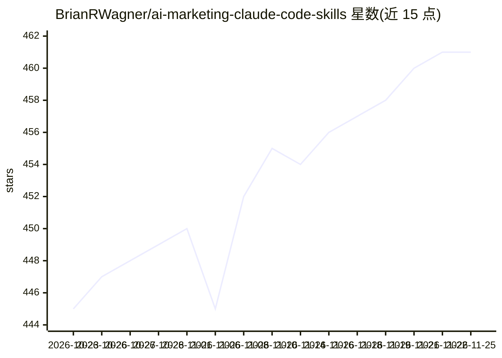

# BrianRWagner/ai-marketing-claude-code-skills

⭐ — · [GitHub]() · 个人维护

**营销类 Agent 技能包：让 Claude Code 等执行 20 个营销框架**

将 20 个营销技能以 SKILL.md 格式打包，覆盖定位、内容、竞品分析、转化与运营五类；每个技能提供框架、提问清单与输出格式，支持 quick/standard/deep 三种执行模式。主要面向 Claude Code 原生使用，并通过脚本与格式转换支持 Cursor、Windsurf、Codex、Copilot 等平台，所有技能为纯 markdown 指令。MIT 许可，作者自述有 15 年以上营销系统经验。

## 筛选速览

| 维度 | 判定 | 备注 |
|---|---|---|
| AI 角色 | `ai-knowledge` | 知识聚合/清单类 |
| 许可风险 | `permissive` | — |
| 部署形态 | `None` |  |
| 模型依赖 | — | README 未给出锁定关系 |
| 硬件要求 | — | 无带数字的原话,不猜 |
| 安装摩擦 | `low` | 无编译、无系统依赖或容器化 |
| 成熟度 | — | 结构信号不足 |

## 能力要点

- 20 个技能按 Strategy/Content/Research/Conversion/Operations 五类组织
- 全部技能支持 quick|standard|deep 三种执行模式
- install.sh 自动检测 Claude Code/Cursor/Windsurf，支持 dry-run
- SKILL.md 纯 markdown 格式，可粘贴到任意助手

## 适用场景

- 让编码 agent 按框架做品牌定位与竞品分析
- 生成与改写符合个人语气的社交媒体内容
- 为 ChatGPT 等搜索场景做品牌可发现性审计

## 场景标签

`AI 写作` · 领域:内容生成

## 证据(README 行号)

> L5: Not guides. Not courses. *Skills* — packaged expertise your AI coding agent loads and follows.
> L21: Agent Skills are an open standard for packaging expertise as instructions that AI agents can follow.

## 星数曲线

2026-10-23 445 → 2026-11-25 461（+16）

---
*卡片 v1 · prompt 1.4 · 生成 2026-11-25 · 置信度 high · 依据 README sha `314709683895` · [字段定义](../../DATASET.md)*
