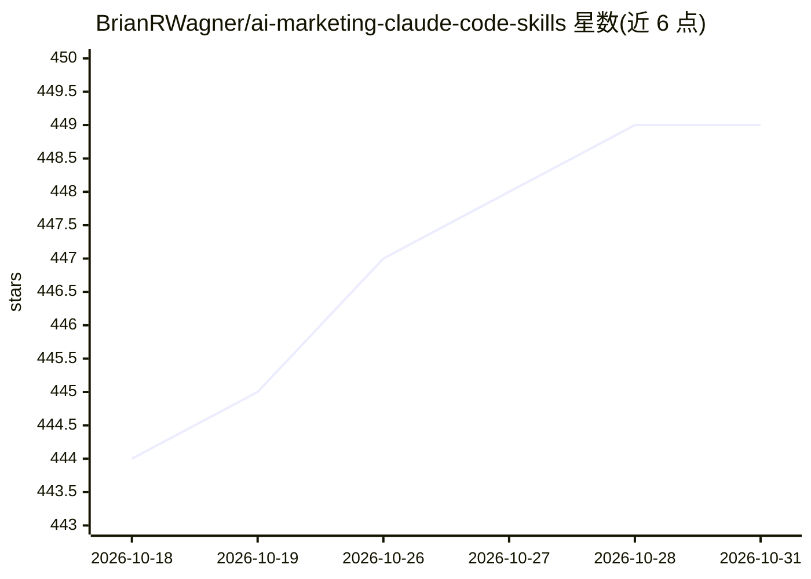

# BrianRWagner/ai-marketing-claude-code-skills

⭐ 449 · Shell · 推送 2026-03-19 · [GitHub](https://github.com/BrianRWagner/ai-marketing-claude-code-skills) · [官网](https://www.brianrwagner.com/) · 个人维护

**面向 Claude Code 的营销技能包：定位/内容/外联等 19 个免费技能**

由个人维护者打包的营销方法论技能集：以 SKILL.md 格式将定位、LinkedIn 内容、冷外联、案例研究、社媒变体生成等 19 个免费技能分发给 AI 编码 agent 加载执行，全部支持 quick|standard|deep 三档执行模式。提供安装脚本，自动检测并安装到 Claude Code、OpenClaw、Cursor、Windsurf 等平台对应目录；每个技能提供 Claude Code 完整版与 OpenClaw 精简版双文件。另有 7 个付费技能在 Gumroad 发售。

## 筛选速览

| 维度 | 判定 | 备注 |
|---|---|---|
| AI 角色 | `ai-knowledge` | 知识聚合/清单类 |
| 许可风险 | `permissive` | — |
| 部署形态 | `None` |  |
| 模型依赖 | — | README 未给出锁定关系 |
| 硬件要求 | — | 无带数字的原话,不猜 |
| 安装摩擦 | `low` | 无编译、无系统依赖或容器化 |
| 成熟度 | — | 结构信号不足 |

## 能力要点

- 19 个免费技能覆盖定位、内容、研究、转化、生产力五类营销场景
- quick|standard|deep 三档执行模式，无需额外提示
- 安装脚本自动检测 Claude Code/OpenClaw/Cursor/Windsurf 并路由对应格式文件
- ChatGPT/Claude.ai 可通过手动粘贴 SKILL.md 使用

## 适用场景

- 让 Claude Code 在对话中自动套用营销框架完成定位或内容任务
- 把营销专业知识作为技能分发给团队的 AI agent
- 审计品牌在 ChatGPT/Perplexity 等 AI 搜索中的可见性

## 场景标签

`AI 写作` `提示工程` · 领域:Agent 开发

## 证据(README 行号)

> L17: Agent Skills are an open standard for packaging expertise as instructions that AI agents can follow.
> L23: Think of it like giving Claude Code a playbook written by an expert. Instead of prompting from scratch every time, 

## 星数曲线

2026-10-18 444 → 2026-10-31 449（+5）

---
*卡片 v1 · prompt 1.4 · 生成 2026-10-21 · 置信度 high · 依据 README sha `fae13ffbc899` · [字段定义](../../DATASET.md)*
