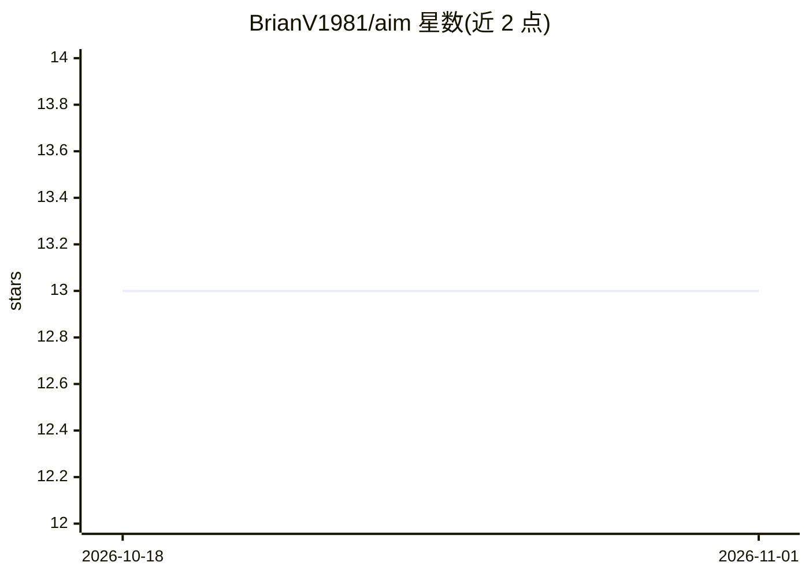

# BrianV1981/aim

⭐ 13 · Python · MIT · 推送 2026-10-25 · [GitHub](https://github.com/BrianV1981/aim) · [官网](https://x.com/BrianV1981) · 个人维护

**面向编码 Agent 的外置记忆系统（已弃用）**

A.I.M.（Actual Intelligent Memory）原为长期运行的 Gemini CLI / ChatGPT Codex / Claude Code 编码 Agent 提供零 token 外置记忆层：外部 SQLite 存储、GitOps 护栏与 DataJack 记忆卡。当前仓库已整体弃用：维护方声明生态已迁移至统一的 aim-joshua（J.O.S.H.U.A.）操作系统，并因 Google 收窄原版 gemini-cli 的可用范围而不再作为主要开发焦点，README 仅保留迁移指引，不再提供可用的安装与使用说明。

## 筛选速览

| 维度 | 判定 | 备注 |
|---|---|---|
| AI 角色 | `ai-ecosystem` | LLM/agent 周边工具 |
| 许可风险 | `permissive` | MIT |
| 部署形态 | `None` |  |
| 模型依赖 | — | README 未给出锁定关系 |
| 硬件要求 | — | 无带数字的原话,不猜 |
| 安装摩擦 | `low` | 无编译、无系统依赖或容器化 |
| 成熟度 | `idea` | |

## 能力要点

- 为编码 Agent 提供零 token 外置 SQLite 记忆
- GitOps 护栏与 DataJack 记忆卡机制（据仓库描述）
- 仓库已弃用，指向继任项目 aim-joshua 与 aim-agy

## 适用场景

- （历史项目）为长会话编码 Agent 提供持久外部记忆
- 按迁移指引转向 aim-joshua 或 aim-agy

## 场景标签

`Agent 记忆` · 领域:Agent 开发

## 证据(README 行号)

> L1: > ⚠️ **DEPRECATED**: This repository has been officially deprecated. The A.I.M. ecosystem has unified its active CLI
> L5: > **IMPORTANT:** Google is sunsetting the original `gemini-cli` for standard subscribers, restricting it to Enterpri

## 星数曲线

2026-10-18 13 → 2026-11-01 13（+0）

---
*卡片 v1 · prompt 1.4 · 生成 2026-10-31 · 置信度 high · 依据 README sha `b810417acbc0` · [字段定义](../../DATASET.md)*
