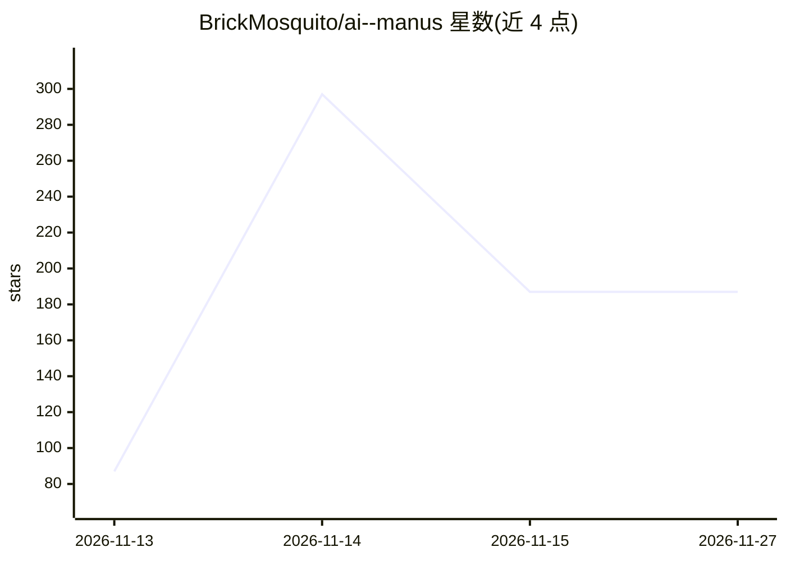

# BrickMosquito/ai--manus

⭐ 187 · Apache-2.0 · 推送 2026-11-15 · [GitHub](https://github.com/BrickMosquito/ai--manus) · 个人维护

**面向日常任务的自主 AI Agent：代跑代码并操控浏览器**

Manus 是一个自主 AI Agent 系统，描述称其可在沙箱环境中运行各类工具与操作：自行编写并执行脚本、控制浏览器完成页面导航、表单填写与信息收集，并支持多步骤任务的低监督执行，定位为个人/学习/轻量办公助手而非企业平台。README 给出了硬件兼容表（最低 4GB 内存、双核 CPU）与上手步骤说明，但未见具体安装命令、模型接入方式或代码仓库结构说明；文末附大量搜索关键词。

## 筛选速览

| 维度 | 判定 | 备注 |
|---|---|---|
| AI 角色 | `ai-native` | 本体是模型或模型工具 |
| 许可风险 | `permissive` | Apache-2.0 |
| 部署形态 | `None` |  |
| 模型依赖 | — | README 未给出锁定关系 |
| 硬件要求 | — | 无带数字的原话,不猜 |
| 安装摩擦 | `low` | 无编译、无系统依赖或容器化 |
| 成熟度 | — | 结构信号不足 |

## 能力要点

- 自主执行代码与脚本完成任务
- 浏览器控制：导航、填表、信息收集
- 代码与浏览器动作可在同一任务流中衔接
- 多步骤任务低监督执行，跨会话保持一致逻辑

## 适用场景

- 让代理代为收集网页资料并整理摘要
- 自动执行重复性小任务如脚本运行、文件整理
- 学习与轻量办公中减少手动操作

## 场景标签

`浏览器自动化` · 领域:效率与自动化

## 证据(README 行号)

> L18: Manus is an autonomous AI agent designed to run code and control a browser on your behalf. Instead of acting like a
> L22: Manus is not a heavy studio suite or a complex enterprise platform. It is a focused helper built for home, study, a

## 星数曲线

2026-11-13 87 → 2026-11-27 187（+100）

---
*卡片 v1 · prompt 1.4 · 生成 2026-11-17 · 置信度 mid · 依据 README sha `fbfd5e977bf4` · [字段定义](../../DATASET.md)*
