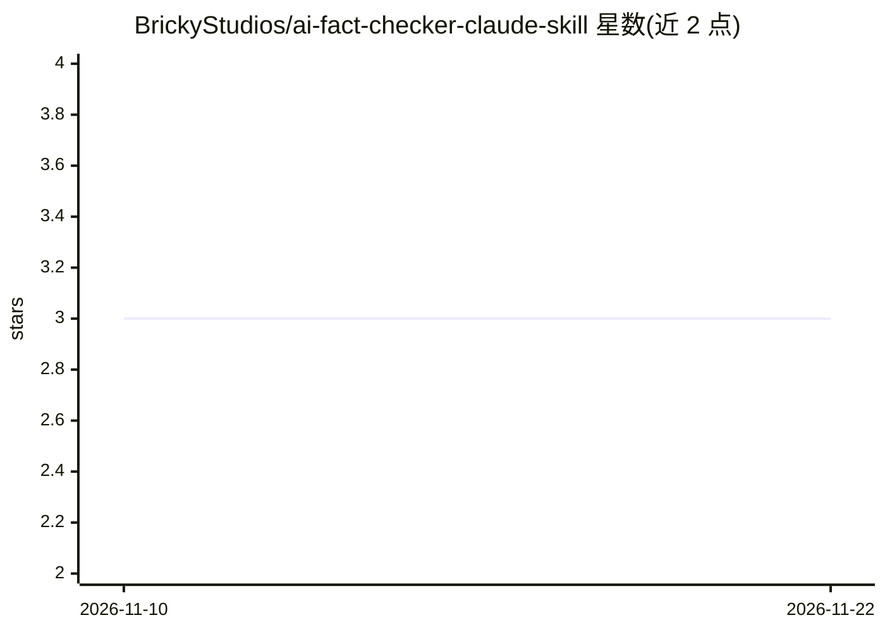

# BrickyStudios/ai-fact-checker-claude-skill

⭐ 3 · Python · MIT · 推送 2026-11-13 · [GitHub](https://github.com/BrickyStudios/ai-fact-checker-claude-skill) · 组织维护

**逐句核查报告与 PDF 事实的 Claude 技能插件**

以 Claude Code 技能形式分发的事实核查工具：Claude 负责读取、检索与判断，配套 Python 脚本负责可机器验证的部分——引文须逐字出现在原文或来源快照、数字用精确小数重算、带数字句子须逐句核查或声明跳过理由，未通过验证的发现降级为 unverified。支持 quick/standard/deep 三档核查深度，输出报告与标注版 PDF，支持 PDF/HTML/Markdown/纯文本，扫描件需先 OCR。需 Python 3.10+，运行依赖用户已有的 Claude 套餐。

## 筛选速览

| 维度 | 判定 | 备注 |
|---|---|---|
| AI 角色 | `ai-native` | 本体是模型或模型工具 |
| 许可风险 | `permissive` | MIT |
| 部署形态 | `None` |  |
| 模型依赖 | locked-api |  |
| 硬件要求 | — | 无带数字的原话,不猜 |
| 安装摩擦 | `low` | 无编译、无系统依赖或容器化 |
| 成熟度 | — | 结构信号不足 |

## 能力要点

- 引文逐字比对与数字精确重算的脚本级验证
- 带数字句子 100% 覆盖核查或声明跳过理由
- quick/standard/deep 三档核查深度，输出标注版 PDF
- 通过 /plugin marketplace 或 git clone 安装

## 适用场景

- 核查年报、报告中的数字计算与前后一致性
- 验证 AI 生成草稿中引用的原句是否真实存在
- 对 PDF 文档逐句做事实核查并标注问题位置

## 场景标签

 · 领域:文档核查/AI 工具

## 证据(README 行号)

> L10: **A free, open-source Claude skill that fact-checks reports, PDFs and AI drafts claim by claim.**
> L12: Ask Claude to check a document and it can still invent a quote or get a sum wrong while checking. This skill splits
> L38: You need Python 3.10+ and, ideally, uv, which installs the PDF libraries by itself. The skill is free. Claude itsel

## 星数曲线

2026-11-10 3 → 2026-11-22 3（+0）

---
*卡片 v1 · prompt 1.4 · 生成 2026-11-22 · 置信度 high · 依据 README sha `4abf588a50e4` · [字段定义](../../DATASET.md)*
