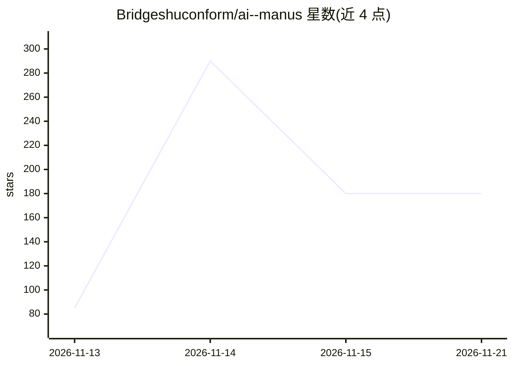

# Bridgeshuconform/ai--manus

⭐ 180 · Apache-2.0 · 推送 2026-11-15 · [GitHub](https://github.com/Bridgeshuconform/ai--manus) · 个人维护

**自主 AI Agent 系统：在沙箱中代用户运行代码与控制浏览器**

Manus 是一个通用自主 AI Agent 系统，描述为可代替用户编写并执行脚本、控制浏览器完成导航、填表、信息采集等多步骤任务，面向家庭、学习与轻量办公场景，无需编程背景。README 说明了代码执行与浏览器控制的协同机制及会话间任务模式记忆，并给出硬件兼容表（最低双核 CPU、4 GB 内存）。README 未提供安装命令、源码结构或技术栈细节，仅有下载提示与配置步骤描述。

## 筛选速览

| 维度 | 判定 | 备注 |
|---|---|---|
| AI 角色 | `ai-native` | 本体是模型或模型工具 |
| 许可风险 | `permissive` | Apache-2.0 |
| 部署形态 | `None` |  |
| 模型依赖 | — | README 未给出锁定关系 |
| 硬件要求 | — | 无带数字的原话,不猜 |
| 安装摩擦 | `low` | 无编译、无系统依赖或容器化 |
| 成熟度 | — | 结构信号不足 |

## 能力要点

- 自主执行代码与控制浏览器完成多步骤任务
- 代码与浏览器操作可在同一任务流中衔接
- 面向非开发者的家庭/学习/轻量办公场景

## 适用场景

- 让 agent 代为完成网页信息采集与表单填写
- 自动运行小脚本与整理研究笔记
- 处理日常重复性小任务以减少手动操作

## 场景标签

`AI 助手` `浏览器自动化` · 领域:效率与自动化

## 证据(README 行号)

> L10: - **Autonomous Code Execution:** Manus AI agent runs code on its own to complete tasks, so you can focus on decisio
> L18: Manus is an autonomous AI agent designed to run code and control a browser on your behalf. Instead of acting like a

## 星数曲线

2026-11-13 85 → 2026-11-21 180（+95）

---
*卡片 v1 · prompt 1.4 · 生成 2026-11-17 · 置信度 low · 依据 README sha `0f78ee3a5dd2` · [字段定义](../../DATASET.md)*
