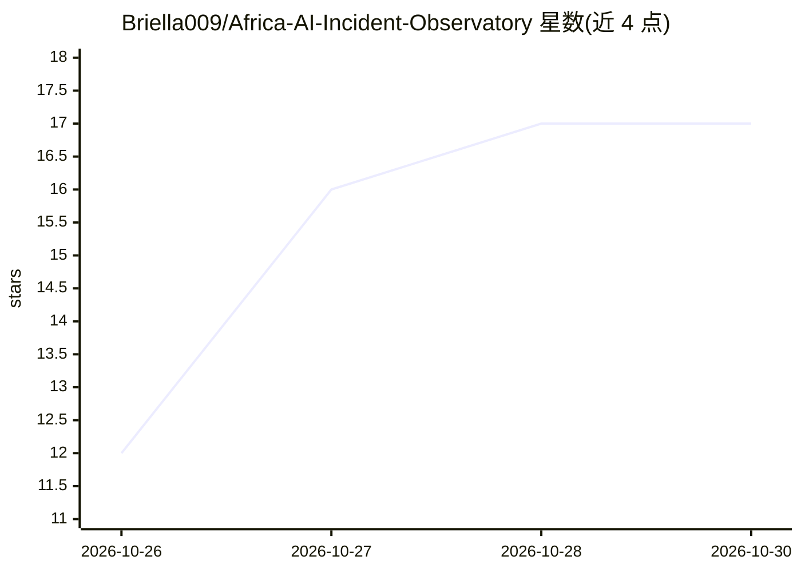

# Briella009/Africa-AI-Incident-Observatory

⭐ 17 · Python · MIT · 推送 2026-10-25 · [GitHub](https://github.com/Briella009/Africa-AI-Incident-Observatory) · [官网](https://aaio-africa.streamlit.app/) · 个人维护

**记录非洲 AI 事件的开源数据集：可溯源的结构化证据**

面向 AI 安全、治理与公共利益研究的开放数据集：将分散的公开报道转化为保留来源溯源、不确定性与证据质量标注的结构化事件记录。当前含 19 条核心事件，覆盖 9 个非洲国家与合成媒体、虚假信息、金融诈骗等主题；设多语言证据层、运营证据层、观察清单与仅追加的变更台账。提供 Streamlit 在线仪表盘、CSV 数据、JSON Schema 校验脚本与 Zenodo DOI 归档，并声明 AIID/OECD 语义互操作映射。数据集声明不具全面性与代表性。

## 筛选速览

| 维度 | 判定 | 备注 |
|---|---|---|
| AI 角色 | `ai-knowledge` | 知识聚合/清单类 |
| 许可风险 | `permissive` | MIT |
| 部署形态 | `library` | 以包/库形式分发 |
| 模型依赖 | — | README 未给出锁定关系 |
| 硬件要求 | — | 无带数字的原话,不猜 |
| 安装摩擦 | `low` | 无编译、无系统依赖或容器化 |
| 成熟度 | — | 结构信号不足 |

## 能力要点

- 19 条核心事件含证据置信度分级（A–D）与严重度评分体系
- 多语言证据层覆盖法语、阿拉伯语、葡萄牙语来源
- AIID/OECD 语义互操作与 DOI 持久化归档
- GitHub Actions 定期审计公开证据链接可达性

## 适用场景

- 研究非洲 AI 事件的结构化公开证据
- 治理与公共利益研究中的事件比较与审计
- 向 AIID 等上游数据库提交非洲案例素材

## 场景标签

 · 领域:AI 安全/治理数据

## 证据(README 行号)

> L3: **A source-traceable, open research dataset for documenting AI incidents affecting African people, institutions and 

## 星数曲线

2026-10-26 12 → 2026-10-30 17（+5）

---
*卡片 v1 · prompt 1.4 · 生成 2026-10-30 · 置信度 mid · 依据 README sha `6efaebb52399` · [字段定义](../../DATASET.md)*
