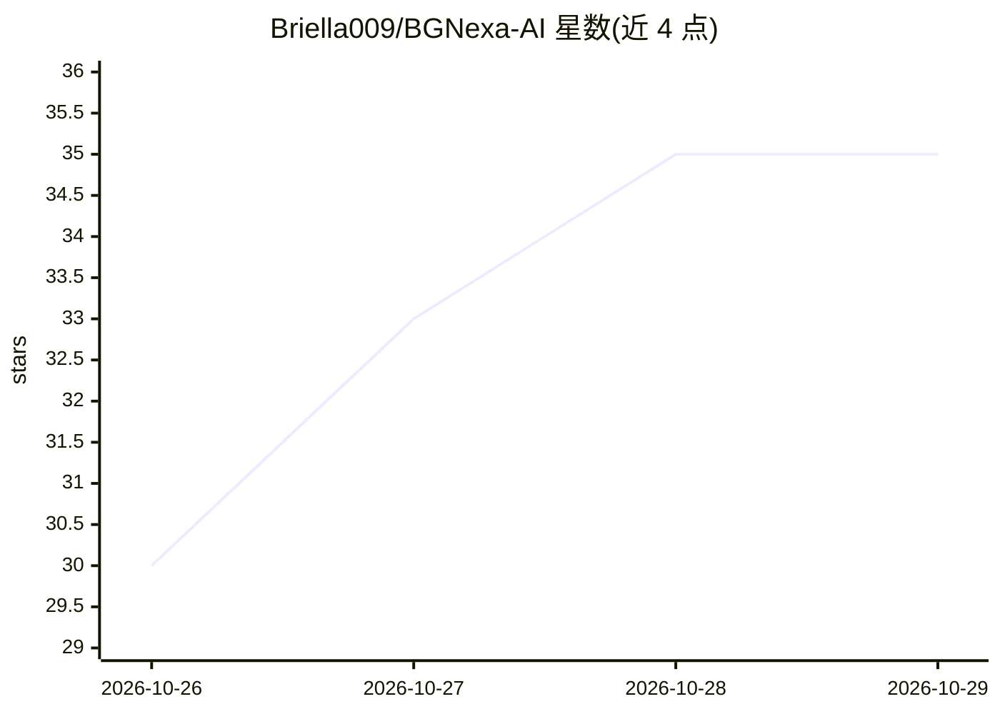

# Briella009/BGNexa-AI

⭐ 35 · Python · MIT · 推送 2026-10-27 · [GitHub](https://github.com/Briella009/BGNexa-AI) · [官网](https://bgnexa-ai.streamlit.app/) · 个人维护

**面向 GRC/审计团队的安全合规证据评估工作台**

开源的证据智能与合规就绪评估工作台，面向 GRC 团队、内审、网络安全与隐私团队。用户上传 PDF/DOCX/TXT/Markdown 证据，系统解析、哈希注册后按适用框架（尼日利亚 NDPA、CBN 网络安全框架、ISO 27001、NIST CSF 2.0、GDPR 等）做确定性适用性判定与本地 TF-IDF 检索，就绪度评分区分暂定与已确认覆盖。AI 评审为可选层（OpenAI/Groq），无 API key 时以人工评审模式运行。含 Assurance Workspace 生成可追溯工作计划与 CSV 导出。当前为 v0.5.1 公测，非生产级多租户平台，不构成法律合规或认证结论。

## 筛选速览

| 维度 | 判定 | 备注 |
|---|---|---|
| AI 角色 | `ai-enhanced` | 去掉 AI 部分产品仍成立 |
| 许可风险 | `permissive` | MIT |
| 部署形态 | `library` | 以包/库形式分发 |
| 模型依赖 | locked-api |  |
| 硬件要求 | — | 无带数字的原话,不猜 |
| 安装摩擦 | `low` | 无编译、无系统依赖或容器化 |
| 成熟度 | `idea` | |

## 能力要点

- 适用性判定在 LLM 之外，由确定性组织/画像规则决定
- 本地 TF-IDF 检索无需 API key，可选语义检索与 AI 评审
- 证据按类型分级、新鲜度信号与提示注入防护护栏
- Assurance Workspace 生成逐控制项工作计划、只追加变更日志与防篡改快照

## 适用场景

- GRC 团队从上传证据建立可辩护的评审留痕
- 按 NDPA/CBN/ISO 27001/NIST CSF/GDPR 做就绪度评估
- 内部审计后续整改的工单化跟踪与导出

## 场景标签

`网络安全` `文档解析` · 领域:知识与检索

## 证据(README 行号)

> L27: BGNexa can run without an API key in deterministic retrieval/manual-review mode.
> L108: BGNexa works without an API key in deterministic retrieval/manual-review mode.
> L110: Optional generation supports OpenAI or Groq. External-AI mode only sends the evidence selected for the request to 

## 星数曲线

2026-10-26 30 → 2026-10-29 35（+5）

---
*卡片 v1 · prompt 1.4 · 生成 2026-10-26 · 置信度 high · 依据 README sha `59481ae82a31` · [字段定义](../../DATASET.md)*
