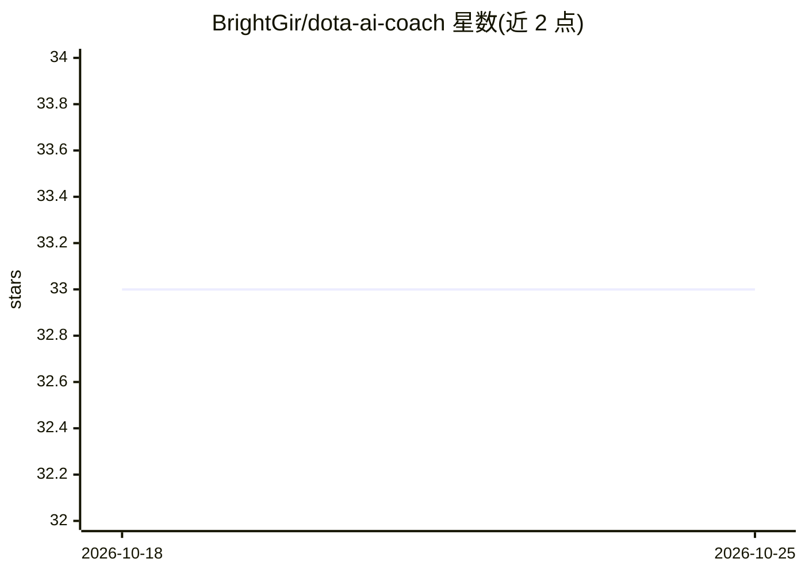

# BrightGir/dota-ai-coach

⭐ 33 · Go · MIT · 推送 2026-02-04 · [GitHub](https://github.com/BrightGir/dota-ai-coach) · 个人维护

**Dota 2 实时战术建议 AI 助手：GSI 读局内状态，悬浮窗给建议**

基于 Go 与 raylib 的 Windows 桌面程序：通过 Dota 2 Game State Integration 读取实时游戏状态（英雄、物品、技能、金币等），结合内置英雄/物品/技能知识库的 RAG 检索（BERT 嵌入 + Chroma DB），调用 Gemini 或 OpenRouter 模型生成战术建议，以游戏内悬浮窗呈现，支持每 N 秒自动建议、局内提问与快捷键控制。需自行配置 GSI 配置文件与 API key，Dota 2 须以窗口模式运行。

## 筛选速览

| 维度 | 判定 | 备注 |
|---|---|---|
| AI 角色 | `ai-native` | 本体是模型或模型工具 |
| 许可风险 | `permissive` | MIT |
| 部署形态 | `desktop` | 安装包/桌面程序 |
| 模型依赖 | locked-api |  |
| 硬件要求 | — | 无带数字的原话,不猜 |
| 安装摩擦 | `low` | 无编译、无系统依赖或容器化 |
| 成熟度 | — | 结构信号不足 |

## 能力要点

- GSI 实时读取游戏状态，悬浮窗展示 AI 建议
- RAG 检索内置英雄/物品/技能知识库（BERT + Chroma DB）
- 支持 Gemini 与 OpenRouter 双提供商、多模型可选
- 每 N 秒自动建议、局内提问与 F9/F10 快捷键

## 适用场景

- 打 Dota 2 时获得实时出装与对线建议
- 局内输入问题询问如何克制对方英雄
- 补充额外上下文让建议更贴合局势

## 场景标签

`AI 助手` `RAG` · 领域:对话与助手

## 证据(README 行号)

> L3: An intelligent AI assistant for Dota 2 that analyzes game situations in real-time and provides tactical advice throu
> L10: - 🤖 **AI Provider Support:** Google Gemini and OpenRouter
> L11: - 🔍 **RAG System:** Searches relevant information from knowledge base before generating responses

## 星数曲线

2026-10-18 33 → 2026-10-25 33（+0）

---
*卡片 v1 · prompt 1.4 · 生成 2026-10-25 · 置信度 high · 依据 README sha `b72c366333f1` · [字段定义](../../DATASET.md)*
