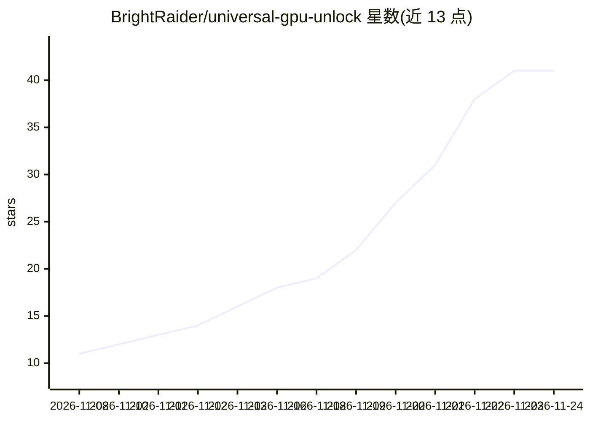

# BrightRaider/universal-gpu-unlock

⭐ 41 · C · GPL-2.0 · 推送 2026-11-22 · [GitHub](https://github.com/BrightRaider/universal-gpu-unlock) · [官网](https://www.igorslab.de/community/threads/community-projekt-universal-1-klick-uefi-booter-ada-4090-rate-limiter-unlock-40-tensor-compute-212-tflops-%E2%80%93-ram-only-kein-vbios-flash.15158/) · 个人维护

**解除 NVIDIA RTX 40/30/20 系 Tensor Core 固件限速的 UEFI 一键工具**

面向 NVIDIA GeForce RTX 40/30/20 系显卡的一键 UEFI 预启动解锁工具：通过 USB 启动盘运行，移除固件层面对 Tensor Core（GEMM 矩阵引擎）的限速，解锁后可在 PyTorch、CUDA、WSL2 等 AI 负载中获得更高的矩阵吞吐。提供 RAM 临时解锁与 NVRAM 持久化两种模式，附验证脚本、仪表盘与快速恢复脚本。限制：需 UEFI 纯模式与 ReBAR 开启，Turing 架构仍在测试中，Secure Boot 需手工注册证书。

## 筛选速览

| 维度 | 判定 | 备注 |
|---|---|---|
| AI 角色 | `ai-ecosystem` | LLM/agent 周边工具 |
| 许可风险 | `viral` | GPL-2.0 |
| 部署形态 | `None` |  |
| 模型依赖 | — | README 未给出锁定关系 |
| 硬件要求 | — | 无带数字的原话,不猜 |
| 安装摩擦 | `medium` | 含编译或系统依赖之一 |
| 成熟度 | `idea` | |

## 能力要点

- 支持 RTX 40/30/20 系（Ada/Ampere/Turing，Turing 测试中）
- RAM 临时解锁与 NVRAM 持久化两种模式
- 附 Check-GPU-Unlock.bat 验证脚本与 GUI 仪表盘
- Fast-Resume 休眠恢复与空闲重锁防护（Idle Guard）

## 适用场景

- 我有一张 RTX 40/30 系显卡，想解除 Tensor Core 限速提升 AI 推理吞吐
- 把闲置消费级显卡作为无头 AI 计算加速卡使用
- ComfyUI/Stable Diffusion 与 LLM 负载下提升矩阵计算速度

## 场景标签

 · 领域:硬件/系统工具

## 证据(README 行号)

> L15:  An automated, universal 1-click UEFI pre-boot unlocker for NVIDIA RTX 40 (Ada), RTX 30 (Ampere) & RTX 20 (Turing) 
> L16:  Unlocks full enterprise-grade Tensor Core compute across Windows 10/11, PyTorch, CUDA, and WSL2.

## 星数曲线

2026-11-08 11 → 2026-11-24 41（+30）

---
*卡片 v1 · prompt 1.4 · 生成 2026-11-18 · 置信度 high · 依据 README sha `42faa5271360` · [字段定义](../../DATASET.md)*
