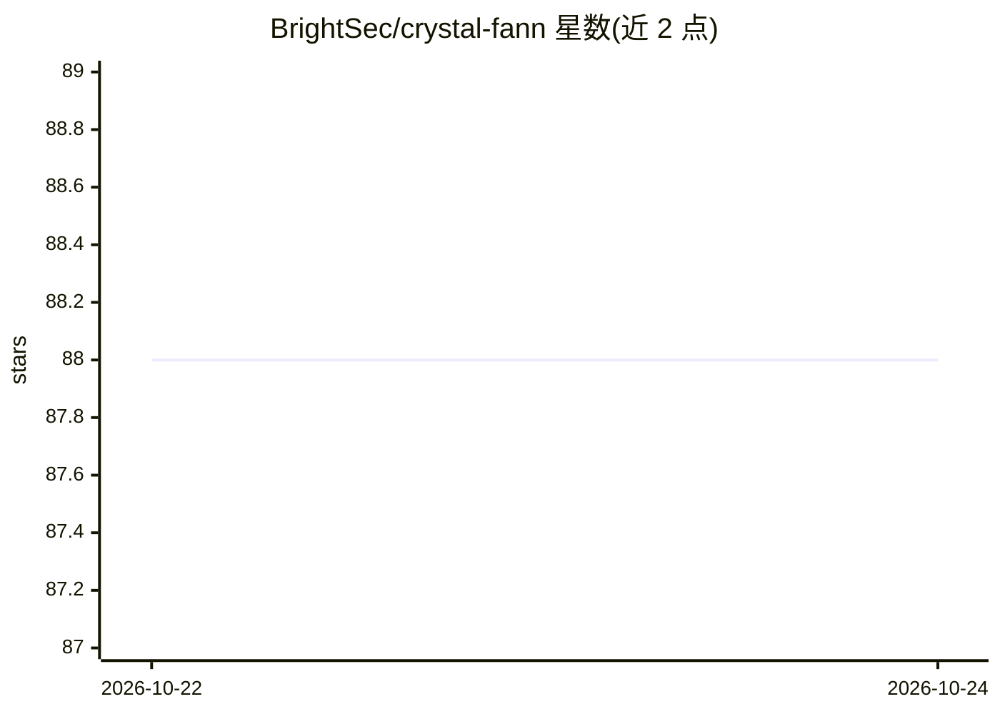

# BrightSec/crystal-fann

⭐ 88 · Crystal · MIT · 推送 2026-01-15 · [GitHub](https://github.com/BrightSec/crystal-fann) · 组织维护

**FANN 神经网络 C 库的 Crystal 语言绑定库**

为 Crystal 语言提供 FANN (Fast Artificial Neural Network) C 库的绑定，通过 shard.yml 依赖引入后可创建标准神经网络与 Cascade2 结构网络、随机化权重、以单样本或批量测试数据训练并运行网络。绑定覆盖 TrainData 类与多 CPU 并行的 Parallel 绑定。README 指出多数函数用法需查阅 spec，C 库文档在 libfann 官网；TODO 中仍留有错误处理与异常等未完成项。

## 筛选速览

| 维度 | 判定 | 备注 |
|---|---|---|
| AI 角色 | `ai-native` | 本体是模型或模型工具 |
| 许可风险 | `permissive` | MIT |
| 部署形态 | `None` |  |
| 模型依赖 | — | README 未给出锁定关系 |
| 硬件要求 | — | 无带数字的原话,不猜 |
| 安装摩擦 | `low` | 无编译、无系统依赖或容器化 |
| 成熟度 | — | 结构信号不足 |

## 能力要点

- Crystal 语言绑定 FANN C 库，经 shard.yml 引入
- 支持 Standard 与 Cascade2（自动构建隐层）网络结构
- 支持批量测试数据训练与多 CPU 并行绑定

## 适用场景

- 在 Crystal 项目中创建和训练前馈神经网络
- 使用 Cascade2 算法自动构建网络结构
- 多 CPU 并行训练神经网络

## 场景标签

 · 领域:机器学习/语言绑定

## 证据(README 行号)

> L7: Crystal bindings for the FANN C lib
> L24: ann = Fann::Network::Standard.new(2, [2], 1)

## 星数曲线

2026-10-22 88 → 2026-10-24 88（+0）

---
*卡片 v1 · prompt 1.4 · 生成 2026-10-23 · 置信度 high · 依据 README sha `0e6763643cdf` · [字段定义](../../DATASET.md)*
