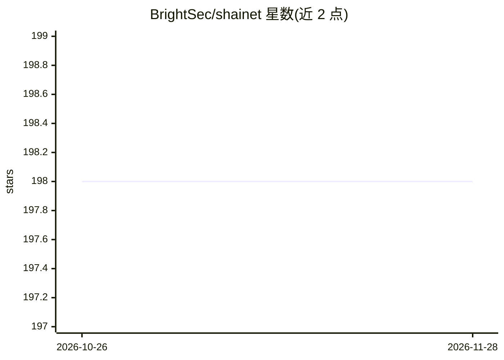

# BrightSec/shainet

⭐ 198 · Crystal · MIT · 推送 2026-11-26 · [GitHub](https://github.com/BrightSec/shainet) · 组织维护

**纯 Crystal 神经网络库：训练与运行神经网络及 LLM 推理**

用纯 Crystal 编写的神经网络库，最初为仿生神经网络研究而建，后发展为通用的神经网络训练与运行库。提供多种层类型与激活函数、SGD/Adam/iRprop+ 等训练算法、面向大数据集的流式训练，支持 CPU 与 CUDA GPU。近年加入 LLM 推理能力：直接加载 GGUF（含 Ollama blob）与 HuggingFace SafeTensors，支持 GPT-2/LLaMA/Mistral/Qwen 系列架构、KV-cache、Q8/Q4 量化、MoE 专家卸载，并提供 OpenAI 兼容 API server 与编码 agent 示例。以 Crystal shard 形式分发，GPU 加速需编译 CUDA 内核。

## 筛选速览

| 维度 | 判定 | 备注 |
|---|---|---|
| AI 角色 | `ai-native` | 本体是模型或模型工具 |
| 许可风险 | `permissive` | MIT |
| 部署形态 | `None` |  |
| 模型依赖 | local-ok | 支持本地模型 |
| 硬件要求 | — | 无带数字的原话,不猜 |
| 安装摩擦 | `high` | 编译与系统依赖俱全 |
| 成熟度 | — | 结构信号不足 |

## 能力要点

- 纯 Crystal 实现，SafeTensors 加载无需 Python/PyTorch
- 直接加载 GGUF（Ollama blob）与 .gguf 文件，内核内反量化与自动层放置
- KV-cache 解码、Q8/Q4 量化、MoE 专家卸载，可在小显存 GPU 运行大模型
- 多种训练算法与流式大数据训练，CUDA/cuDNN GPU 加速

## 适用场景

- 在 Crystal 项目中训练常规神经网络（如分类）
- 本地加载并推理 GGUF/HuggingFace 格式的 LLM
- 通过 OpenAI 兼容端点给现有客户端提供本地模型服务
- 在 16 GB 显卡上运行 27B 级量化模型

## 场景标签

`推理引擎` `模型量化` · 领域:训练与推理

## 证据(README 行号)

> L3: SHAInet (Super Human Artificial Intelligence Network) is a neural network library written in pure Crystal. Originall
> L12: - LLM inference: GPT-2, LLaMA, Mistral, Qwen2, Qwen3, Qwen3-MoE, and Qwen3.5
> L153: Supported architectures: **GPT-2, LLaMA, Mistral, Qwen2, Qwen3, Qwen3-MoE, Qwen3.5**.

## 星数曲线

2026-10-26 198 → 2026-11-28 198（+0）

---
*卡片 v1 · prompt 1.4 · 生成 2026-11-25 · 置信度 high · 依据 README sha `00f04dd3b277` · [字段定义](../../DATASET.md)*
