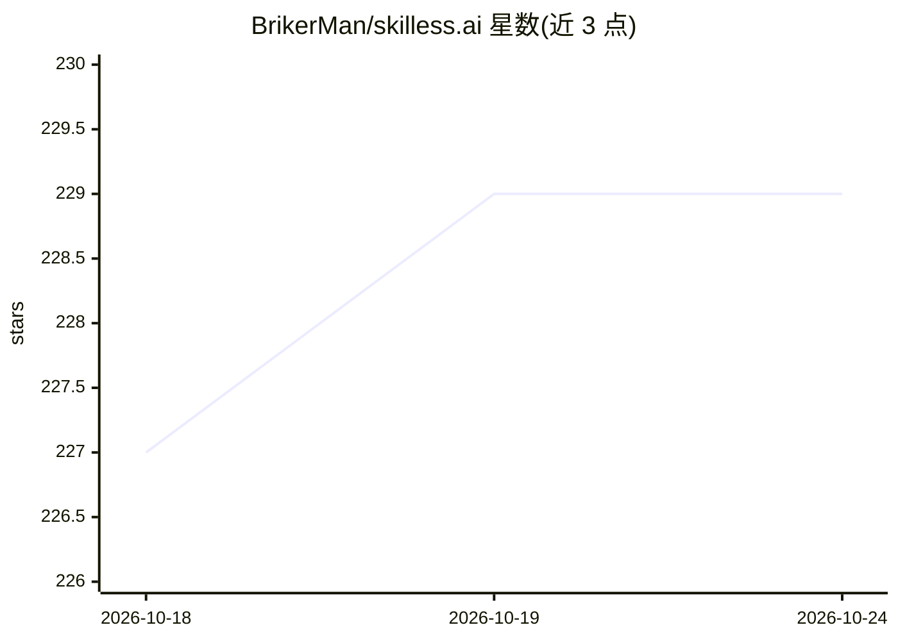

# BrikerMan/skilless.ai

⭐ 229 · Astro · 推送 2026-07-04 · [GitHub](https://github.com/BrikerMan/skilless.ai) · [官网](https://skilless.ai) · 个人维护 · 中文 README

**给 AI Agent 装上真实数据能力的技能包安装器**

面向使用 OpenCode、Cursor、Claude Code 等 SKILL.md 兼容 agent 的用户，通过一行安装脚本在 ~/.agents/skills/skilless/ 部署隔离虚拟环境（含 yt-dlp、Jina Reader、Exa、feedparser），使 agent 获得 Web 搜索、网页内容提取、1700+ 站点视频下载与字幕提取、RSS 解析及媒体转码能力；另附带 Brainstorming/Research/Writing 三个 SKILL.md 技能。全部依赖使用免费通道，无需 API key、无需 sudo，可用一条命令卸载。

## 筛选速览

| 维度 | 判定 | 备注 |
|---|---|---|
| AI 角色 | `ai-ecosystem` | LLM/agent 周边工具 |
| 许可风险 | `none` | — |
| 部署形态 | `None` |  |
| 模型依赖 | — | README 未给出锁定关系 |
| 硬件要求 | — | 无带数字的原话,不猜 |
| 安装摩擦 | `low` | 无编译、无系统依赖或容器化 |
| 成熟度 | — | 结构信号不足 |

## 能力要点

- 一行脚本安装，隔离虚拟环境部署，零系统污染
- Web 搜索/网页提取/1700+ 站点视频下载与字幕提取/RSS 解析
- 附带 Brainstorming、Research、Writing 三个 SKILL.md 技能
- 全部工具走免费通道，无需 API key

## 适用场景

- 让编程 agent 直接联网搜索并阅读网页做调研
- 在对话中下载 YouTube/Bilibili 视频并提取字幕与摘要
- 让 agent 基于多来源交叉验证生成研究报告

## 场景标签

`网页抓取` `科研工具` · 领域:效率与自动化

## 证据(README 行号)

> L85: Skills are installed as `SKILL.md` files under `~/.agents/skills/`. Your Agent reads them automatically and knows w
> L149: Any tool that reads SKILL.md files from `~/.agents/skills/` will work. We recommend **OpenCode** — it's open sourc

## 星数曲线

2026-10-18 227 → 2026-10-24 229（+2）

---
*卡片 v1 · prompt 1.4 · 生成 2026-10-22 · 置信度 high · 依据 README sha `804cb758f3f9` · [字段定义](../../DATASET.md)*
