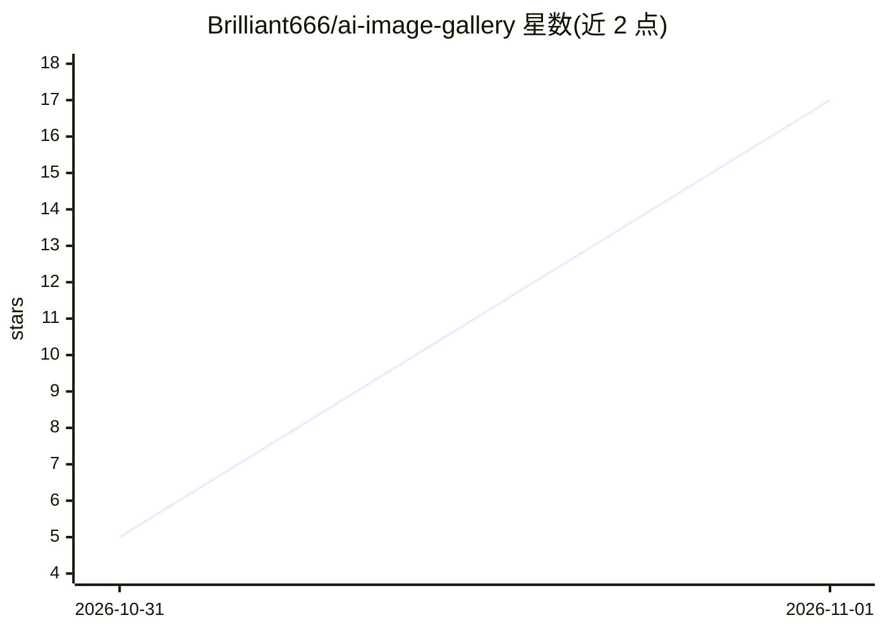

# Brilliant666/ai-image-gallery

⭐ 17 · HTML · NOASSERTION · 推送 2026-10-31 · [GitHub](https://github.com/Brilliant666/ai-image-gallery) · [官网](https://photoai.life/) · 个人维护 · 中文 README

**AI 绘画参考图库：五个静态站收录 15,241 张人像/姿势/服装参考图**

单仓多站的 AI 绘画参考素材库：五个静态站点分别收录人像（1,499 张，CC0）、姿势线稿与深度图（各 1,439 张）、服装（1,407 件/4,221 张）及 CC0 姿势线稿，中日双语界面，支持筛选、搜索、灯箱与原图下载；深度图标注可直接用于 ControlNet。仓库不含图片文件，由 Python 脚本从原站下载、生成中图并构建零依赖的单 index.html 站点（无框架/CDN/外部字体），提供部署、校验与测试脚本。除两个 CC0 站外其余素材禁止再分发，项目自述为个人学习用途的中文镜像。

## 筛选速览

| 维度 | 判定 | 备注 |
|---|---|---|
| AI 角色 | `ai-knowledge` | 知识聚合/清单类 |
| 许可风险 | `none` | NOASSERTION |
| 部署形态 | `library` | 以包/库形式分发 |
| 模型依赖 | — | README 未给出锁定关系 |
| 硬件要求 | — | 无带数字的原话,不猜 |
| 安装摩擦 | `low` | 无编译、无系统依赖或容器化 |
| 成熟度 | — | 结构信号不足 |

## 能力要点

- 五个站点共 15,241 张参考图，中日双语、深浅色主题
- 深度图模块标注可直接用于 ControlNet
- 零依赖静态站：单 index.html、无框架/CDN/外部字体
- Python 工具链覆盖下载、生成中图、构建、校验、发布与测试

## 适用场景

- AI 绘画时查找角色脸部、姿势、服装参考图
- 为 ControlNet 流程获取姿势线稿与灰度深度图
- 自建镜像站点浏览与部署参考图库

## 场景标签

`精选清单` · 领域:学习与行业

## 证据(README 行号)

> L3: **五个 AI 绘画参考图库，一个仓库构建，一个目录部署**
> L44: |人像集|保持角色脸部一致性的人脸参考，按发型筛选|1,499 张|**CC0**|
> L46: |姿势集 · 深度图|同一模块的深度图入口，灰度深度图可直接用于 ControlNet|1,439 张|禁止再分发|

## 星数曲线

2026-10-31 5 → 2026-11-01 17（+12）

---
*卡片 v1 · prompt 1.4 · 生成 2026-11-01 · 置信度 mid · 依据 README sha `5a668146fffb` · [字段定义](../../DATASET.md)*
