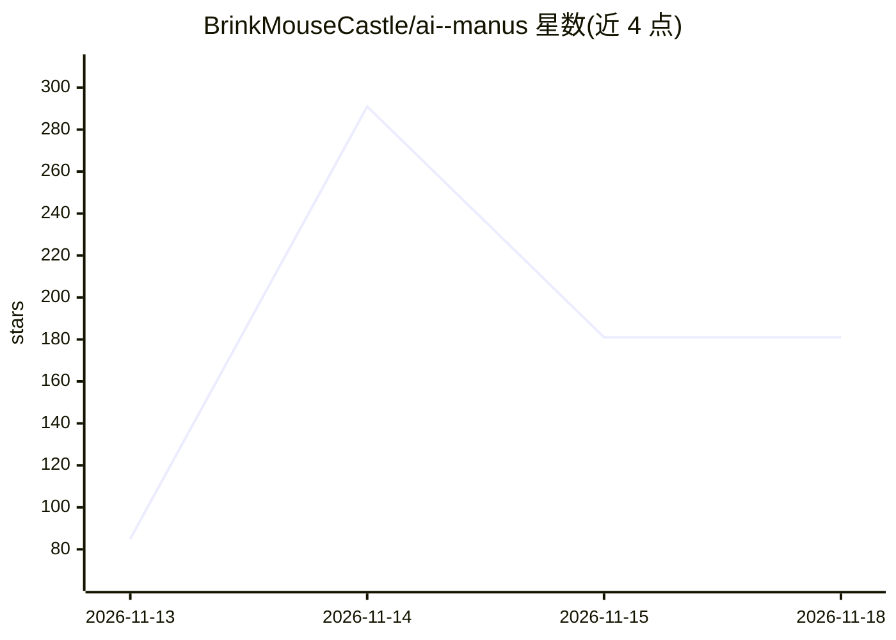

# BrinkMouseCastle/ai--manus

⭐ 181 · Apache-2.0 · 推送 2026-11-15 · [GitHub](https://github.com/BrinkMouseCastle/ai--manus) · 个人维护

**面向个人用户的自主 AI Agent：代为执行代码与浏览器操作**

README 描述了一个自主 AI Agent：用户以自然语言下达指令，Agent 自行编写并执行脚本、控制浏览器（导航网页、填写表单、抓取信息），完成多步骤任务，定位为家庭、学习与轻量办公场景的个人助理，面向非开发者。兼容性表列出最低双核 CPU、4 GB 内存等要求。但 README 未给出任何安装命令、源码结构或 API 接入方式，仅含一个下载链接与促销码，仓库实际内容无法从 README 核验。

## 筛选速览

| 维度 | 判定 | 备注 |
|---|---|---|
| AI 角色 | `ai-native` | 本体是模型或模型工具 |
| 许可风险 | `permissive` | Apache-2.0 |
| 部署形态 | `None` |  |
| 模型依赖 | — | README 未给出锁定关系 |
| 硬件要求 | — | 无带数字的原话,不猜 |
| 安装摩擦 | `low` | 无编译、无系统依赖或容器化 |
| 成熟度 | — | 结构信号不足 |

## 能力要点

- Agent 可自主编写并执行代码完成多步骤任务
- 浏览器控制：导航网页、填表单、收集信息
- 面向家庭、学习与轻量办公的小规模任务场景

## 适用场景

- 让 Agent 代为执行重复性的脚本与网页操作
- 学习中整理研究笔记、运行小脚本
- 从多个网页收集信息并生成摘要

## 场景标签

`AI 助手` `浏览器自动化` · 领域:效率与自动化

## 证据(README 行号)

> L10: - **Autonomous Code Execution:** Manus AI agent runs code on its own to complete tasks, so you can focus on decisio
> L18: Manus is an autonomous AI agent designed to run code and control a browser on your behalf. Instead of acting like a
> L41: |**Memory (RAM)**|4 GB|8 GB or more for heavy Manus autonomous tasks|

## 星数曲线

2026-11-13 85 → 2026-11-18 181（+96）

---
*卡片 v1 · prompt 1.4 · 生成 2026-11-17 · 置信度 low · 依据 README sha `0f78ee3a5dd2` · [字段定义](../../DATASET.md)*
