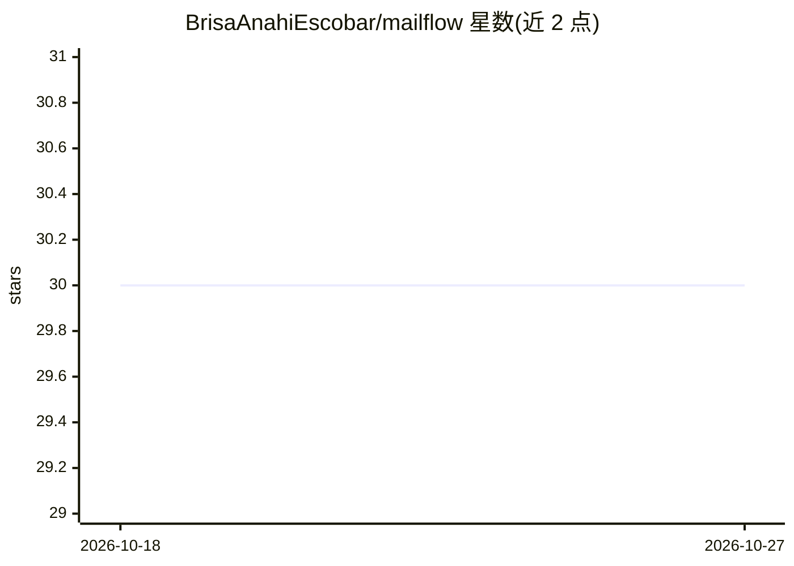

# BrisaAnahiEscobar/mailflow

⭐ 30 · Dart · 推送 2026-09-28 · [GitHub](https://github.com/BrisaAnahiEscobar/mailflow) · 个人维护

**网页版 Gmail 助手：把邮件转为语音播放，AI 摘要在开发中**

个人开发中的 Web 邮件助手，基于 Flutter Web 构建，通过 Google OAuth 2.0 授权接入 Gmail API，实现邮件获取、查看与 Text-to-Speech 语音播放，面向通勤等无法阅读屏幕的场景。AI 摘要、智能优先级、自动分类与语音交互目前列于“开发中”尚未实现。规划引入 Spring Boot 后端与 PostgreSQL，技术栈含 Docker；重大决策以 ADR 文档记录于 docs/ 目录。作者为信息系统工程专业学生，定位为学习与实验项目。

## 筛选速览

| 维度 | 判定 | 备注 |
|---|---|---|
| AI 角色 | `ai-enhanced` | 去掉 AI 部分产品仍成立 |
| 许可风险 | `none` | — |
| 部署形态 | `None` |  |
| 模型依赖 | — | README 未给出锁定关系 |
| 硬件要求 | — | 无带数字的原话,不猜 |
| 安装摩擦 | `low` | 无编译、无系统依赖或容器化 |
| 成熟度 | `idea` | |

## 能力要点

- Google OAuth 2.0 授权接入 Gmail API，获取并展示邮件
- Text-to-Speech 将邮件转为语音播放
- AI 摘要/优先级/分类/语音交互列于路线图尚未实现
- 规划 Spring Boot 后端 + PostgreSQL，决策以 ADR 记录

## 适用场景

- 通勤或不便看屏时用耳朵收听 Gmail 邮件
- 长邮件的 AI 摘要快速获取要点（功能开发中）
- 作为 Flutter + Gmail API + TTS 集成的学习参考项目

## 场景标签

`语音合成` · 领域:内容生成

## 证据(README 行号)

> L5: **MailFlow** es un asistente de correo electrónico web que transforma los emails en audio mediante **Text-to-Speech*
> L60: * Resúmenes de emails mediante IA
> L155: * [ ] Resúmenes de emails

## 星数曲线

2026-10-18 30 → 2026-10-27 30（+0）

---
*卡片 v1 · prompt 1.4 · 生成 2026-10-26 · 置信度 high · 依据 README sha `e1aedf8433d2` · [字段定义](../../DATASET.md)*
