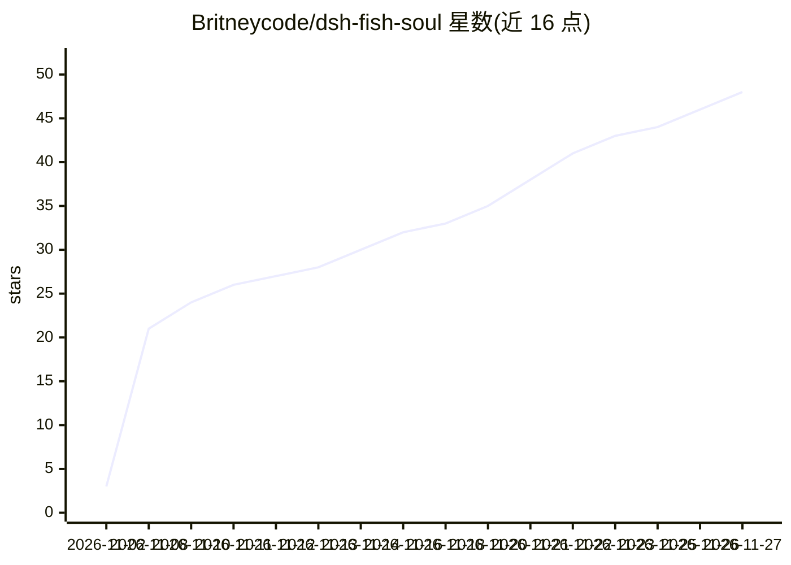

# Britneycode/dsh-fish-soul

⭐ 48 · JavaScript · 推送 2026-11-26 · [GitHub](https://github.com/Britneycode/dsh-fish-soul) · 个人维护 · 中文 README

**DSH 插件：给 QQ 小号装上单角色人格与按人记忆**

DSH 宿主的单角色人格插件（角色 feiyu）：让一个 QQ 小号以固定人格与人交流，记忆按人隔离、可纠正、可导入旧聊天记录，支持艾宾浩斯衰减与每周存档。通过 SnowLuma（OneBot 11）接入 QQ，群聊默认拒绝需白名单，未送达回复排队重发；另支持 B站/抖音私信与自动刷视频。人格兼容 SillyTavern 角色卡与世界书，语音听/说可分别配置 OpenAI 兼容、百炼、MiniMax、豆包等。按功能选模型并统计用量花费，需 Node ≥ 22.5，抖音功能需常开 Windows 桌面。

## 筛选速览

| 维度 | 判定 | 备注 |
|---|---|---|
| AI 角色 | `ai-native` | 本体是模型或模型工具 |
| 许可风险 | `none` | — |
| 部署形态 | `library` | 以包/库形式分发 |
| 模型依赖 | — | README 未给出锁定关系 |
| 硬件要求 | — | 无带数字的原话,不猜 |
| 安装摩擦 | `low` | 无编译、无系统依赖或容器化 |
| 成熟度 | — | 结构信号不足 |

## 能力要点

- 按人隔离记忆：BM25+向量 RRF 召回、艾宾浩斯衰减、可纠正、旧聊天记录断点续传导入
- 7 个人格模板与 SillyTavern 角色卡/世界书导入，人格随长期证据缓慢演化
- QQ 直连 SnowLuma，群默认拒绝、白名单控制，未送达回复持久化排队重发
- QQ 语音听说：听/说可各配 STT/TTS 服务（OpenAI 兼容/百炼/MiniMax/豆包等）

## 适用场景

- 让 QQ/B站/抖音小号以同一个固定人格长期陪伴式聊天
- 导入旧聊天记录，让角色对熟人保留历史印象
- 按天×功能×模型查看用量与花费，控制多模型成本

## 场景标签

`Agent 记忆` `聊天机器人` `语音合成` · 领域:Agent 开发

## 证据(README 行号)

> L3: 让一个 QQ 小号背后有"同一个人"：固定人格、按人记记忆、有自己的生活节奏、会主动开口；同一个"她"同时出现在 QQ、B站、抖音。
> L13: |人格|设置页「人格」：7 个内置模板一键换上（第一个「肥鱼 · 通用」只定性格和说话方式、生活细节聊着聊着才有，后面 6 个带现成的生活细节）、可视化编辑、导入 / 导出 SillyTavern 角色卡（PNG / JSON）、
> L14: |记忆|按人隔离、本轮即时召回（BM25 + 向量 RRF）、艾宾浩斯衰减（重要度高不淡）、可纠正（留旧档）、出处 `evidence`、每人 ≤150 字印象、8 栏结构化印象、关系阶段演进、好感与情绪、旧聊天记录导入（断点续传

## 星数曲线

2026-11-02 3 → 2026-11-27 48（+45）

---
*卡片 v1 · prompt 1.4 · 生成 2026-11-18 · 置信度 mid · 依据 README sha `adc2f1825d13` · [字段定义](../../DATASET.md)*
