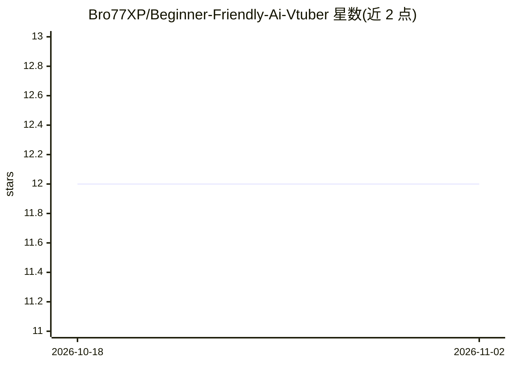

# Bro77XP/Beginner-Friendly-Ai-Vtuber

⭐ 12 · Python · 推送 2026-10-22 · [GitHub](https://github.com/Bro77XP/Beginner-Friendly-Ai-Vtuber) · 个人维护

**面向非程序员的 AI VTuber：语音对话+Live2D 动画驱动**

用 Python 编写的桌面 AI VTuber 程序，面向新手/非程序员：Whisper(base.en) 做英文语音识别，Ollama(llama3.2) 生成回复，Chatterbox TTS 朗读并支持 zero-shot 声音克隆，循环监听直至 Ctrl+C。通过 VTube Studio 插件同步口型与情绪动画，附 TCN 神经动作引擎（头部、眨眼、视线、眉毛，30fps），支持 Twitch 聊天回应与 OBS 字幕。代码主要支持 CPU（在 AMD GPU 上开发），需自建 venv 并安装 Ollama、VTube Studio 等外部工具。

## 筛选速览

| 维度 | 判定 | 备注 |
|---|---|---|
| AI 角色 | `ai-native` | 本体是模型或模型工具 |
| 许可风险 | `none` | — |
| 部署形态 | `library` | 以包/库形式分发 |
| 模型依赖 | local-ok | 支持本地模型 |
| 硬件要求 | — | 无带数字的原话,不猜 |
| 安装摩擦 | `medium` | 含编译或系统依赖之一 |
| 成熟度 | — | 结构信号不足 |

## 能力要点

- Whisper 语音识别 + Ollama LLM + Chatterbox TTS 的持续监听循环
- VTube Studio 集成：口型同步、情绪热键触发动画
- TCN 神经动作引擎以 30fps 输出头部、眨眼、视线、眉毛等自然动作
- Twitch 聊天实时回应与 OBS 字幕输出

## 适用场景

- 直播时用语音或 Twitch 聊天与 AI VTuber 互动
- 无独立显卡的电脑上运行本地 AI VTuber
- 通过参考音频给 VTuber 克隆自定义声音

## 场景标签

`语音 Agent` · 领域:对话与助手

## 证据(README 行号)

> L3: An AI VTuber that uses Whisper for speech recognition, Ollama for LLM inference, and Chatterbox TTS in a continuous 
> L16: - **Whisper** (base.en model) - Real-time speech-to-text in English with adaptive noise VAD
> L17: - **Ollama** (llama3.2) - AI model for generating VTuber responses
> L18: - **Chatterbox Turbo TTS And Chatterbox nano** - Fast text-to-speech with zero-shot voice cloning

## 星数曲线

2026-10-18 12 → 2026-11-02 12（+0）

---
*卡片 v1 · prompt 1.4 · 生成 2026-11-02 · 置信度 high · 依据 README sha `167e458de276` · [字段定义](../../DATASET.md)*
