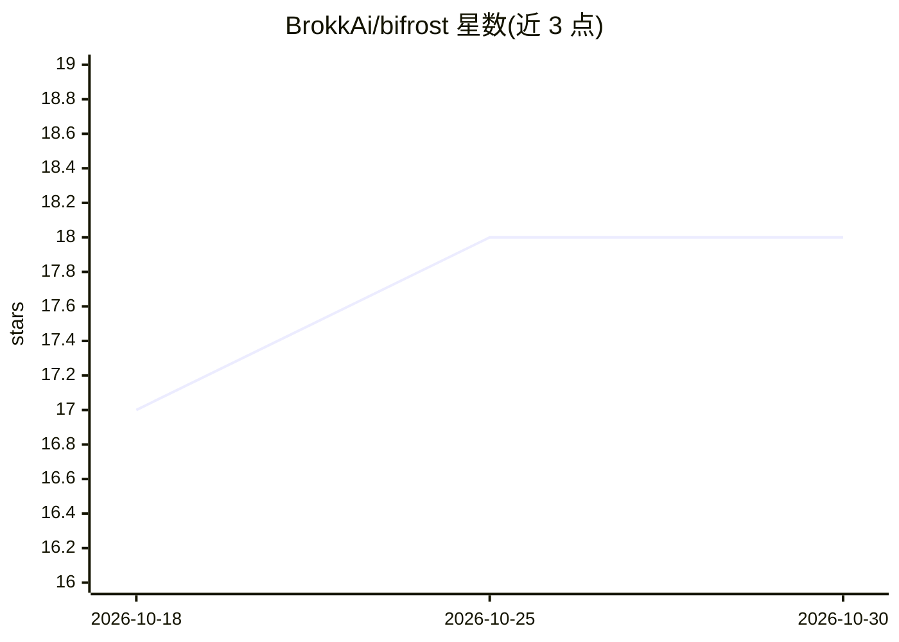

# BrokkAi/bifrost

⭐ 18 · Rust · Apache-2.0 · 推送 2026-10-29 · [GitHub](https://github.com/BrokkAi/bifrost) · [官网](https://bifrost.brokk.ai/) · 组织维护

**面向 AI 编码代理与编辑器的多语言静态分析工具箱**

Brokk 用 Rust 编写的代码智能分析工具箱，为编码代理、编辑器与大型仓库提供服务。核心机制：为 13 种语言提供共享中间表示（Rune IR），支持 JSON CodeQuery 与 RQL 查询语言做跨语言结构查询；通过 MCP 工具暴露给编码代理，通过 LSP 提供给编辑器，同一分析器可经 CLI、Python、Rust 调用。支持快照隔离、增量更新、内容缓存与 git/worktree 感知。安装方式覆盖安装脚本、pipx/uv、npm、brew，Windows 需从源码构建，Alpine 无预编译版本。

## 筛选速览

| 维度 | 判定 | 备注 |
|---|---|---|
| AI 角色 | `ai-ecosystem` | LLM/agent 周边工具 |
| 许可风险 | `permissive` | Apache-2.0 |
| 部署形态 | `library` | 以包/库形式分发 |
| 模型依赖 | — | README 未给出锁定关系 |
| 硬件要求 | — | 无带数字的原话,不猜 |
| 安装摩擦 | `low` | 无编译、无系统依赖或容器化 |
| 成熟度 | — | 结构信号不足 |

## 能力要点

- 13 种语言（C/C++/Java/Python/Rust 等）共享统一中间表示
- RQL 与 JSON CodeQuery 查询语言，跨语言结构查询
- 同时暴露为 MCP 工具与 LSP 服务，CLI/Python/Rust 可调用同一分析器
- 快照隔离、增量更新与 git/worktree 感知，适配持续变化的大型仓库

## 适用场景

- 为编码代理提供结构化代码导航与查询工具（MCP）
- 在编辑器（VS Code/Zed）中获得跨语言 LSP 功能
- 对混合语言大型仓库做跨语言结构分析与审计查询

## 场景标签

 · 领域:开发者工具/代码分析

## 证据(README 行号)

> L20: `bifrost` is Brokk's Rust-based static analysis toolbox for AI coding harnesses,
> L32: - **Built for agents and editors.** Expose structured MCP tools to coding
> L33:  agents, LSP features to editors, and the same analyzer through the CLI,

## 星数曲线

2026-10-18 17 → 2026-10-30 18（+1）

---
*卡片 v1 · prompt 1.4 · 生成 2026-10-29 · 置信度 high · 依据 README sha `97d35f46b872` · [字段定义](../../DATASET.md)*
