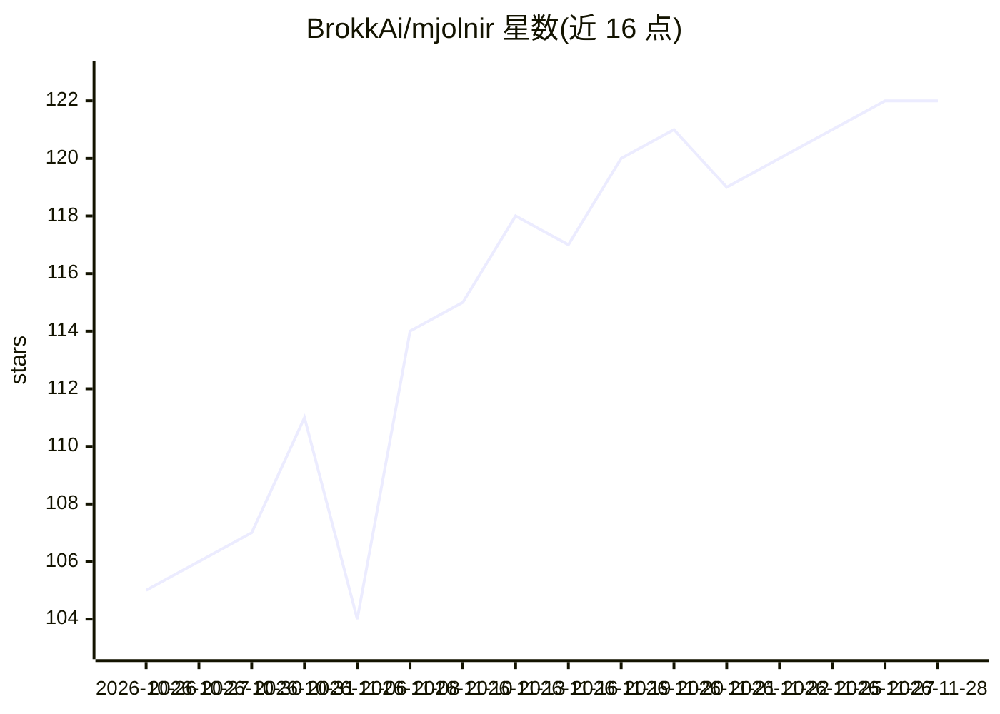

# BrokkAi/mjolnir

⭐ 122 · Rust · GPL-3.0 · 推送 2026-11-27 · [GitHub](https://github.com/BrokkAi/mjolnir) · [官网](https://mjolnir.slopcop.com/) · 组织维护

**为开发者统一管理多个编程 Agent 会话的终端与 Web 控制台**

Mjolnir 是基于 Rust 的终端仪表盘与后台服务，用于管理 Claude Code、Codex、Kimi Code、Grok Build、Muse Code、OpenCode、DSH 等编程 Agent，兼容 Agent Client Protocol（ACP）。核心机制包括：会话与终端解耦（关闭终端后 Agent 继续运行并可恢复）、跨账号/跨机器的会话迁移与检查点、按 Agent 维护多账号订阅配额、隔离的工作区检出、委托子 Agent 分工并回收报告，以及独立审查者对提交的代码做检查。会话可运行在本地、Docker/Podman 容器、SSH 主机或 EC2。默认会把最近对话文本发送到托管的 Jev 分类器以判断 Agent 状态，可在设置中关闭。提供终端仪表盘、Web 查看器与 HTTP API。

## 筛选速览

| 维度 | 判定 | 备注 |
|---|---|---|
| AI 角色 | `ai-ecosystem` | LLM/agent 周边工具 |
| 许可风险 | `viral` | GPL-3.0 |
| 部署形态 | `library` | 以包/库形式分发 |
| 模型依赖 | — | README 未给出锁定关系 |
| 硬件要求 | — | 无带数字的原话,不猜 |
| 安装摩擦 | `low` | 无编译、无系统依赖或容器化 |
| 成熟度 | — | 结构信号不足 |

## 能力要点

- 会话脱离终端持久运行，支持检查点与恢复迁移
- 支持本地、容器、SSH、EC2 等多种运行目标
- 多账号配额监控，限额后可在重置时自动恢复
- 通过 mj CLI、HTTP API 或 mj acp（编辑器接入）脚本化驱动会话

## 适用场景

- 同时管理多个仓库和多个订阅的编程 Agent 会话
- 离开电脑后让 Agent 任务继续运行并在回来时恢复现场
- 在不同账号或不同机器间迁移进行中的会话
- 推送前由独立审查者检查已提交的代码改动

## 场景标签

`编码 Agent` `代码审查` · 领域:编码与开发

## 证据(README 行号)

> L5: Mjolnir (`mj`) is a terminal dashboard and background service for Claude Code,
> L6: Codex, Kimi Code, Grok Build, Muse Code, OpenCode, and DSH. Each session runs

## 星数曲线

2026-10-26 105 → 2026-11-28 122（+17）

---
*卡片 v1 · prompt 1.4 · 生成 2026-11-28 · 置信度 high · 依据 README sha `5a2185c0ca30` · [字段定义](../../DATASET.md)*
