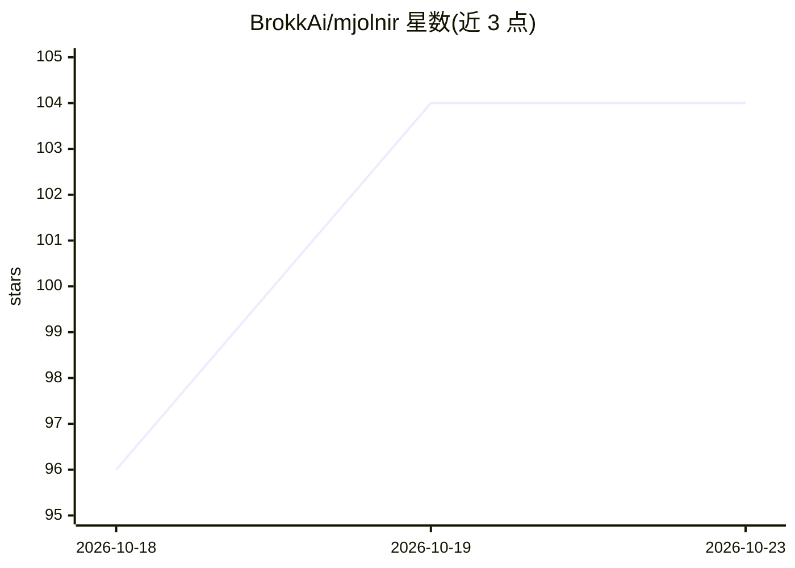

# BrokkAi/mjolnir

⭐ 104 · Rust · GPL-3.0 · 推送 2026-10-22 · [GitHub](https://github.com/BrokkAi/mjolnir) · [官网](https://mjolnir.brokk.ai/) · 组织维护

**多编程 Agent 统一控制平面：会话持久化、隔离环境与配额管理**

Rust 编写的终端与 Web 控制平面，用于并行运行 Claude Code、Codex、Kimi Code、Grok Build、Muse Code、OpenCode 等 ACP 编程 Agent。会话由 worker 持有提示队列与事件日志，终端关闭或守护进程重启后可恢复；支持本地、Docker/Podman/Apple 容器、SSH 主机与 EC2 作为运行目标，可在账号、harness 与机器间迁移会话。提供配额总览、多仓库项目捆绑、独立审阅者对抗审查与 HTTP API/ACP 接口。默认向 TypeSafe 托管的 Jev 分类器发送提示文本，可在 config.toml 中关闭。面向同时使用多个 Agent 订阅与多仓库的开发者。

## 筛选速览

| 维度 | 判定 | 备注 |
|---|---|---|
| AI 角色 | `ai-ecosystem` | LLM/agent 周边工具 |
| 许可风险 | `viral` | GPL-3.0 |
| 部署形态 | `library` | 以包/库形式分发 |
| 模型依赖 | — | README 未给出锁定关系 |
| 硬件要求 | — | 无带数字的原话,不猜 |
| 安装摩擦 | `low` | 无编译、无系统依赖或容器化 |
| 成熟度 | — | 结构信号不足 |

## 能力要点

- 会话独立于终端存活，可断开重连并跨账号/harness/主机迁移
- 支持本地、容器、SSH、EC2 等运行目标，按需上传 worker
- 多 harness 配额集中查看与多配置档案管理
- 提供 HTTP API、CLI 与 stdio ACP 客户端接入

## 适用场景

- 同时管理多个编程 Agent 订阅与会话
- 让 Agent 任务在离开终端或重启后继续运行
- 把会话从个人账号迁移到工作账号或从本机迁到 EC2
- 通过手机经 Tailscale 用 Web 查看会话

## 场景标签

`编码 Agent` `代码审查` · 领域:编码与开发

## 证据(README 行号)

> L5: Mjolnir (`mj`) runs Claude Code, Codex, Kimi Code, Grok Build, Muse Code,
> L52: - **Agent and editor integration.** Drive sessions through `mj new`, `mj prompt`,

## 星数曲线

2026-10-18 96 → 2026-10-23 104（+8）

---
*卡片 v1 · prompt 1.4 · 生成 2026-10-23 · 置信度 high · 依据 README sha `700bc56ba058` · [字段定义](../../DATASET.md)*
