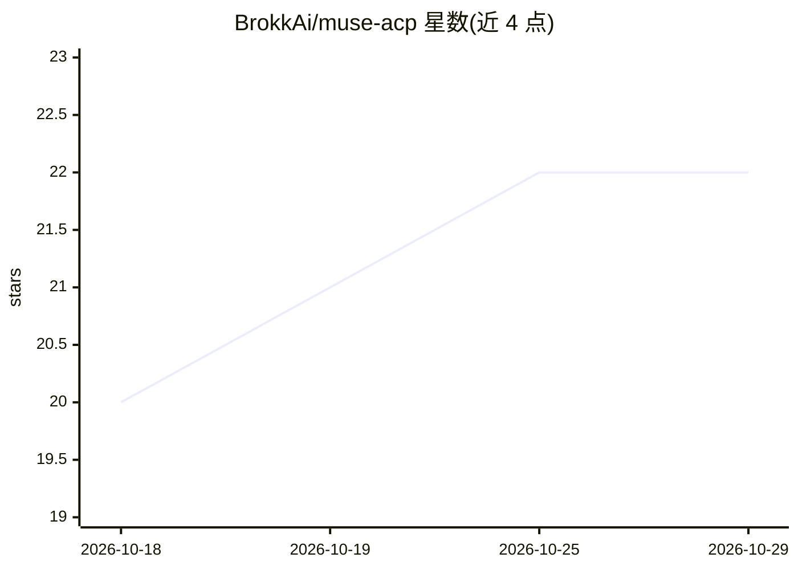

# BrokkAi/muse-acp

⭐ 22 · Rust · Apache-2.0 · 推送 2026-10-28 · [GitHub](https://github.com/BrokkAi/muse-acp) · [官网](https://github.com/BrokkAi/muse-acp/releases/latest) · 组织维护

**让 Zed 与 JetBrains 等 ACP 客户端使用 Muse Code 订阅的 Rust 适配器**

连接支持 Agent Client Protocol (ACP) 的编辑器与 Meta Muse Code 的桥接程序：通过 Muse 原生会话协议 (MSP) 与 `muse serve` 通信，复用订阅自带的会话引擎、工具、认证与审批流，支持 ACP v1/v2。单一 Rust 二进制、无运行时依赖，跨 macOS/Linux/Windows。提供 install/install-intellij 命令自动注册 Zed 与 JetBrains 配置；含每会话 Auto-review 机制，由第二个只读 Muse 会话代替用户审批权限请求，并支持 Default/Read-only/Plan 三种模式。工作区另含可复用的 acp-lite 同步 ACP SDK。属独立社区项目，与 Meta 无隶属关系。

## 筛选速览

| 维度 | 判定 | 备注 |
|---|---|---|
| AI 角色 | `ai-ecosystem` | LLM/agent 周边工具 |
| 许可风险 | `permissive` | Apache-2.0 |
| 部署形态 | `desktop` | 安装包/桌面程序 |
| 模型依赖 | — | README 未给出锁定关系 |
| 硬件要求 | — | 无带数字的原话,不猜 |
| 安装摩擦 | `low` | 无编译、无系统依赖或容器化 |
| 成熟度 | — | 结构信号不足 |

## 能力要点

- 单一 Rust 二进制、零运行时依赖，支持 ACP v1/v2
- install / install-intellij 自动注册 Zed 与 JetBrains IDE 配置（带 .bak 备份与原子写入）
- 每会话 Auto-review：由独立只读 Muse 会话输出 ALLOW/DENY 审批结论
- Default / Read-only / Plan 三种会话模式，模式状态持久化

## 适用场景

- 在 Zed 或 IntelliJ 等 JetBrains IDE 中使用已有的 Muse Code 订阅
- 让 AI 编码代理的权限审批由审阅代理自动决策而非逐条点击
- 以只读或计划模式在编辑器中让 Muse 调研并提方案

## 场景标签

`编码 Agent` · 领域:编码与开发

## 证据(README 行号)

> L11: `muse-acp` is a bridge between editors that speak the
> L18: The adapter is one small Rust binary with no runtime dependencies. It supports
> L83: - **Muse Code** installed, authenticated, and available as `muse` on `PATH`.

## 星数曲线

2026-10-18 20 → 2026-10-29 22（+2）

---
*卡片 v1 · prompt 1.4 · 生成 2026-10-28 · 置信度 high · 依据 README sha `0ead199e077a` · [字段定义](../../DATASET.md)*
