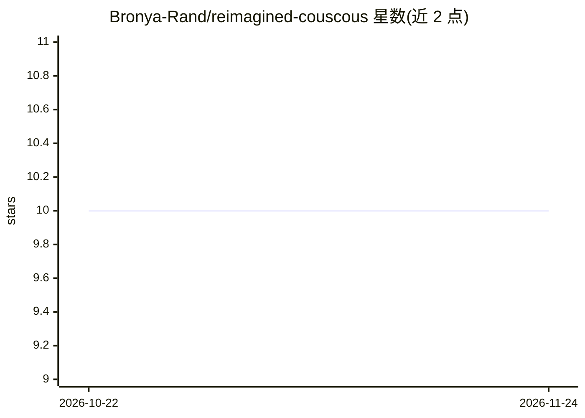

# Bronya-Rand/reimagined-couscous

⭐ 10 · SCSS · 推送 2026-07-27 · [GitHub](https://github.com/Bronya-Rand/reimagined-couscous) · [官网](https://bronya-rand.github.io/reimagined-couscous/) · 个人维护

**面向 AI 文本生成社区的 HoYoverse 角色机器人卡片合集**

作者自建的 AI 角色机器人归档页面，收录其为 AI text-gen 社区创作的 character bot，以 HoYoverse/miHoYo 角色为主，兼有 Wuthering Waves、FFXIV、Slayers 等其他作品角色。浏览方式为通过 Bot List 找到角色后下载 character card/JSON 文件；部分角色来自用户请求，作者接受委托创作。站点以 GitHub Pages 形式发布，作者说明选择 GitHub 而非 Rentry 是为便于回溯。

## 筛选速览

| 维度 | 判定 | 备注 |
|---|---|---|
| AI 角色 | `ai-knowledge` | 知识聚合/清单类 |
| 许可风险 | `none` | — |
| 部署形态 | `None` |  |
| 模型依赖 | — | README 未给出锁定关系 |
| 硬件要求 | — | 无带数字的原话,不猜 |
| 安装摩擦 | `low` | 无编译、无系统依赖或容器化 |
| 成熟度 | — | 结构信号不足 |

## 能力要点

- 提供可下载的 character card/JSON 文件
- 以 HoYoverse/miHoYo 角色为主，含 Wuthering Waves、XIV、Slayers 等
- 支持按 Bot List 浏览并接受角色委托

## 适用场景

- 下载 HoYoverse 角色的 character card 用于 AI 文本生成
- 查找其他作品（如 Wuthering Waves）的角色 bot
- 委托作者制作特定角色 bot

## 场景标签

`聊天机器人` · 领域:对话与助手

## 证据(README 行号)

> L6: Why hello there! Welcome to this collection of bots that I decided to create out of fun for the AI text-gen communit
> L12: Simply put, you will find some character bots that I created either for fun, saw someone (or several people) reques

## 星数曲线

2026-10-22 10 → 2026-11-24 10（+0）

---
*卡片 v1 · prompt 1.4 · 生成 2026-11-20 · 置信度 high · 依据 README sha `276fc227221f` · [字段定义](../../DATASET.md)*
