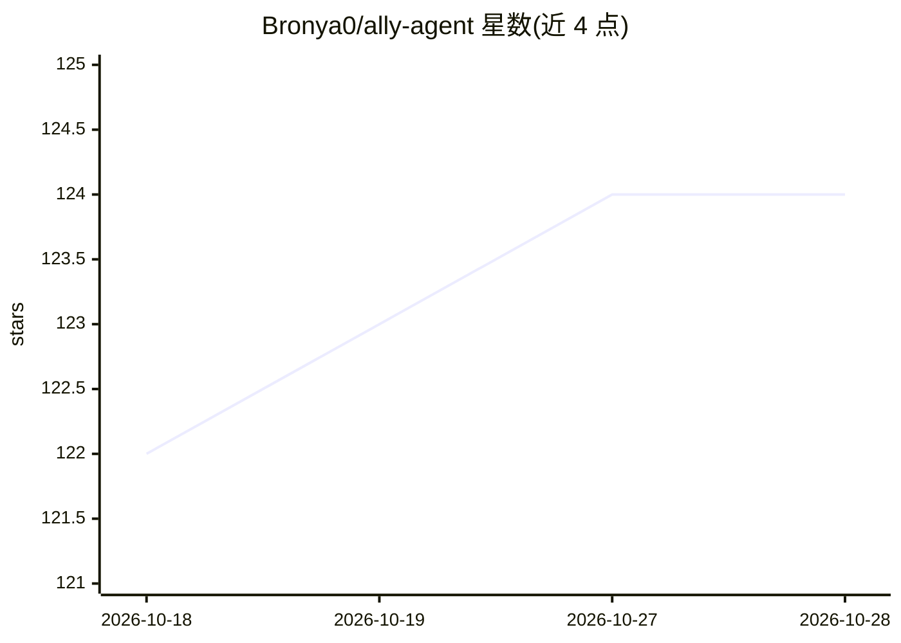

# Bronya0/ally-agent

⭐ 124 · Go · GPL-3.0 · 推送 2026-10-27 · [GitHub](https://github.com/Bronya0/ally-agent) · [官网](https://bronya0.github.io/ally-agent/) · 个人维护 · 中文 README

**面向本地项目的桌面 AI 编程助手**

基于 Wails 构建的桌面 AI 编程助手，通过自然语言对话理解代码、读写文件、搜索工作区、管理任务与执行开发工作。支持 OpenAI Chat Completions/Responses、Anthropic Messages 及兼容服务，提供多 API key 故障转移、按工作区选模型、并行子代理、MCP 接入、插件与 Skills 扩展机制。可在本地及远程 SSH 工作区操作，提供 Windows/macOS/Linux 安装包。

## 筛选速览

| 维度 | 判定 | 备注 |
|---|---|---|
| AI 角色 | `ai-native` | 本体是模型或模型工具 |
| 许可风险 | `viral` | GPL-3.0 |
| 部署形态 | `desktop` | 安装包/桌面程序 |
| 模型依赖 | — | README 未给出锁定关系 |
| 硬件要求 | — | 无带数字的原话,不猜 |
| 安装摩擦 | `low` | 无编译、无系统依赖或容器化 |
| 成熟度 | — | 结构信号不足 |

## 能力要点

- 支持 OpenAI 与 Anthropic 多种 API 格式及兼容模型服务
- 并行子代理、MCP 服务器（stdio/SSE/Streamable HTTP）接入
- zip 插件系统扩展侧边栏页面，内置 Skills 与跨项目记忆
- 本地与远程 SSH 工作区的文件操作、命令执行与后台任务管理

## 适用场景

- 通过对话让 AI 理解并修改我的本地项目代码
- 在远程 SSH 服务器上用对话完成文件编辑与命令执行
- 接入自有模型服务作为日常编程助手

## 场景标签

`编码 Agent` · 领域:编码与开发

## 证据(README 行号)

> L5: A desktop AI coding assistant that works with your local projects. Ally helps you understand code, edit files, searc
> L27: - Use OpenAI Chat Completions, OpenAI Responses, Anthropic Messages, and compatible model services

## 星数曲线

2026-10-18 122 → 2026-10-28 124（+2）

---
*卡片 v1 · prompt 1.4 · 生成 2026-10-23 · 置信度 high · 依据 README sha `b24b71a93fc5` · [字段定义](../../DATASET.md)*
