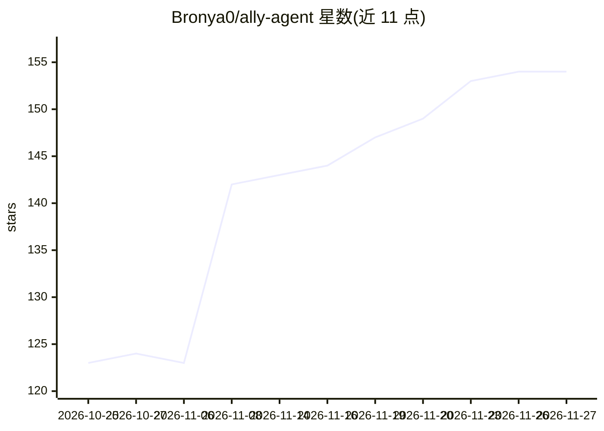

# Bronya0/ally-agent

⭐ 154 · Go · GPL-3.0 · 推送 2026-11-26 · [GitHub](https://github.com/Bronya0/ally-agent) · [官网](https://bronya0.github.io/ally-agent/) · 个人维护 · 中文 README

**面向本地项目的桌面 AI 编程助手，对话式改码与远程开发**

用 Go 与 MyGo 构建的原生桌面 AI 编程助手，跨 Windows/macOS/Linux。通过对话读写文件、搜索工作区、运行命令、并行子代理拆解任务，并支持授权 SSH 节点做远程开发与文件传输。接入 OpenAI/Anthropic 兼容服务或 ChatGPT 登录，支持多 API Key 故障转移、MCP 工具、Skills 自动发现、JS/TS 插件系统、无头运行与本地 HTTP API。安装包从 Releases 下载，macOS 未公证需手动放行。

## 筛选速览

| 维度 | 判定 | 备注 |
|---|---|---|
| AI 角色 | `ai-native` | 本体是模型或模型工具 |
| 许可风险 | `viral` | GPL-3.0 |
| 部署形态 | `desktop` | 安装包/桌面程序 |
| 模型依赖 | — | README 未给出锁定关系 |
| 硬件要求 | — | 无带数字的原话,不猜 |
| 安装摩擦 | `medium` | 含编译或系统依赖之一 |
| 成熟度 | — | 结构信号不足 |

## 能力要点

- 多工作区并行开发与带段号的分阶段并发工具调用
- SSH 远程节点读写、命令执行与文件传输
- MCP（stdio/SSE/Streamable HTTP）、Skills 自动发现与 JS/TS 插件系统
- prompt 缓存前缀复用、多 API Key 故障转移与 Token 用量仪表盘

## 适用场景

- 在本地项目里通过对话理解代码、批量修改文件
- 通过 SSH 把编码任务交给远程主机执行
- 用插件和 MCP 扩展侧栏工具页面
- 服务器上以无头模式运行并通过 HTTP API 调用

## 场景标签

`编码 Agent` · 领域:编码与开发

## 证据(README 行号)

> L5: Ally Agent 是一款轻量的原生桌面 AI 编程助手，使用 Go 与 MyGo 构建，支持 Windows、macOS 和 Linux。通过对话理解项目、修改代码、运行命令，也可以授权 SSH 节点，把工作交给远程主机。
> L34: - 支持 OpenAI Chat Completions、OpenAI Responses、Anthropic Messages 及兼容服务，也可通过 ChatGPT 登录接入已授权账号的模型。

## 星数曲线

2026-10-25 123 → 2026-11-27 154（+31）

---
*卡片 v1 · prompt 1.4 · 生成 2026-11-27 · 置信度 high · 依据 README sha `8a9bc460f9b3` · [字段定义](../../DATASET.md)*
