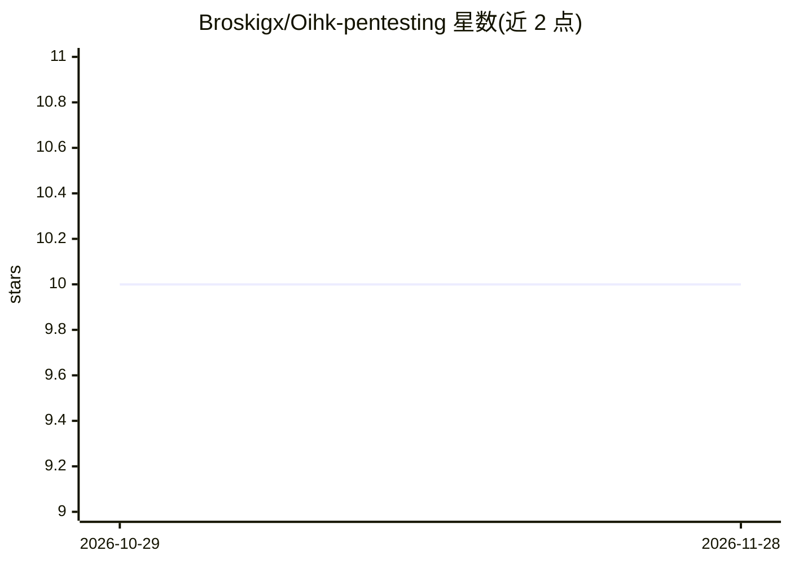

# Broskigx/Oihk-pentesting

⭐ 10 · Python · MIT · 推送 2026-11-01 · [GitHub](https://github.com/Broskigx/Oihk-pentesting) · [官网](https://oihk.site) · 个人维护

**面向授权安全评估的多智能体自主渗透测试引擎**

以根规划器调度侦察、发现、攻击（提权）、验证与报告等子代理的多智能体渗透测试引擎，内置作用域 DNS 锁定、出口 fail-closed 网络隔离、证据门与资源治理，发现项需真实执行证据加独立验证记录。默认对接 LM Studio 等 OpenAI 兼容本地端点，也可经 /apimodel 接入云端模型；交互式助手 Baron 提供 164 工具 RAG 语料、OSINT 支点与最多 7 个并行沙盒子代理。当前为早期 beta，行为可能变更，macOS 未测试。

## 筛选速览

| 维度 | 判定 | 备注 |
|---|---|---|
| AI 角色 | `ai-native` | 本体是模型或模型工具 |
| 许可风险 | `permissive` | MIT |
| 部署形态 | `None` |  |
| 模型依赖 | local-ok | 支持本地模型 |
| 硬件要求 | — | 无带数字的原话,不猜 |
| 安装摩擦 | `low` | 无编译、无系统依赖或容器化 |
| 成熟度 | `idea` | |

## 能力要点

- 证据门机制：发现项需真实工具执行证据加独立验证代理的验证记录
- 作用域编译为沙箱网络命名空间内的 netfilter 白名单，出口 fail-closed
- 模型无关核心：任意 OpenAI 兼容端点，支持按角色路由不同模型
- 附带的 mock 求解器在其 24 场景基准上可完全离线复现评分

## 适用场景

- 在授权范围内对目标主机做自动化侦察与漏洞验证
- 生成含 PoC 与修复建议的自包含 HTML 渗透测试报告
- 本地模型上离线评估安全代理的执行能力
- 用勒索软件就绪探针检验文件访问审计的覆盖情况

## 场景标签

`多智能体` `网络安全` · 领域:Agent 开发

## 证据(README 行号)

> L15: **OIHK-pentesting** is an autonomous multi-agent engine for **authorized**
> L17: (Privesc), validation, and reporting agents — and the engine itself enforces
> L263: OIHK doubles as its own eval environment: the real engine runs against 24

## 星数曲线

2026-10-29 10 → 2026-11-28 10（+0）

---
*卡片 v1 · prompt 1.4 · 生成 2026-11-20 · 置信度 mid · 依据 README sha `108df6efcf79` · [字段定义](../../DATASET.md)*
