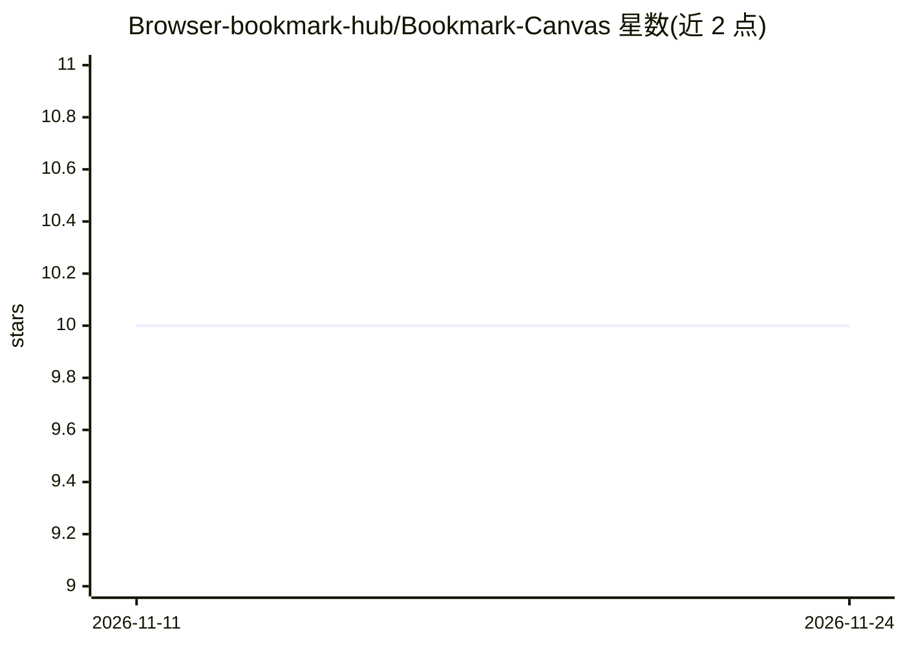

# Browser-bookmark-hub/Bookmark-Canvas

⭐ 10 · JavaScript · GPL-3.0 · 推送 2026-11-22 · [GitHub](https://github.com/Browser-bookmark-hub/Bookmark-Canvas) · 组织维护 · 中文 README

**基于 JSON Canvas 的 Chrome/Edge 书签可视化画布管理器**

Manifest V3 浏览器扩展，将浏览器书签呈现为画布工作区：永久分区映射书签树，另有临时分区、空白分区、卡片组与方向连接。支持本地导入导出画布包，可 Push/Pull 到 GitHub 仓库。导出包内置 AGENTS_template 规则文件，供 Claude Code、Codex、DeepSeek Harness 等编码 Agent 主机安全理解数据边界；配套只读研究插件（Skill + 本地 MCP）用于索引检索书签内容。安装途径为 Chrome Web Store 与 Edge Add-ons。

## 筛选速览

| 维度 | 判定 | 备注 |
|---|---|---|
| AI 角色 | `ai-enhanced` | 去掉 AI 部分产品仍成立 |
| 许可风险 | `viral` | GPL-3.0 |
| 部署形态 | `None` |  |
| 模型依赖 | — | README 未给出锁定关系 |
| 硬件要求 | — | 无带数字的原话,不猜 |
| 安装摩擦 | `low` | 无编译、无系统依赖或容器化 |
| 成熟度 | — | 结构信号不足 |

## 能力要点

- 永久分区直接映射浏览器书签树，临时分区采用移动语义
- 画布包本地导入导出，支持 GitHub Push/Pull 同步
- 导出包内置 AGENTS_template 供 AI Agent 读取数据边界
- 配套只读 Bookmark Research 插件（Skill + 本地 MCP + CLI）

## 适用场景

- 在可视化画布上空间化管理大量浏览器书签
- 通过 GitHub 仓库同步与备份画布数据
- 让编码 Agent 依据规则文件安全读取/编辑书签数据

## 场景标签

 · 领域:浏览器工具/书签管理

## 证据(README 行号)

> L33: `Bookmark-Canvas` is a Manifest V3 bookmark manager for Chrome / Edge. It combines browser bookmarks with a visual 
> L9: A companion read-only research plugin (Skill + local MCP) specifically designed for Bookmark Canvas exported package
> L94: - [x] **Default rule-file co-building**: Improve the `AGENTS.md` / `CLAUDE.md`-style rules included with exported a

## 星数曲线

2026-11-11 10 → 2026-11-24 10（+0）

---
*卡片 v1 · prompt 1.4 · 生成 2026-11-20 · 置信度 high · 依据 README sha `61e77e373faf` · [字段定义](../../DATASET.md)*
