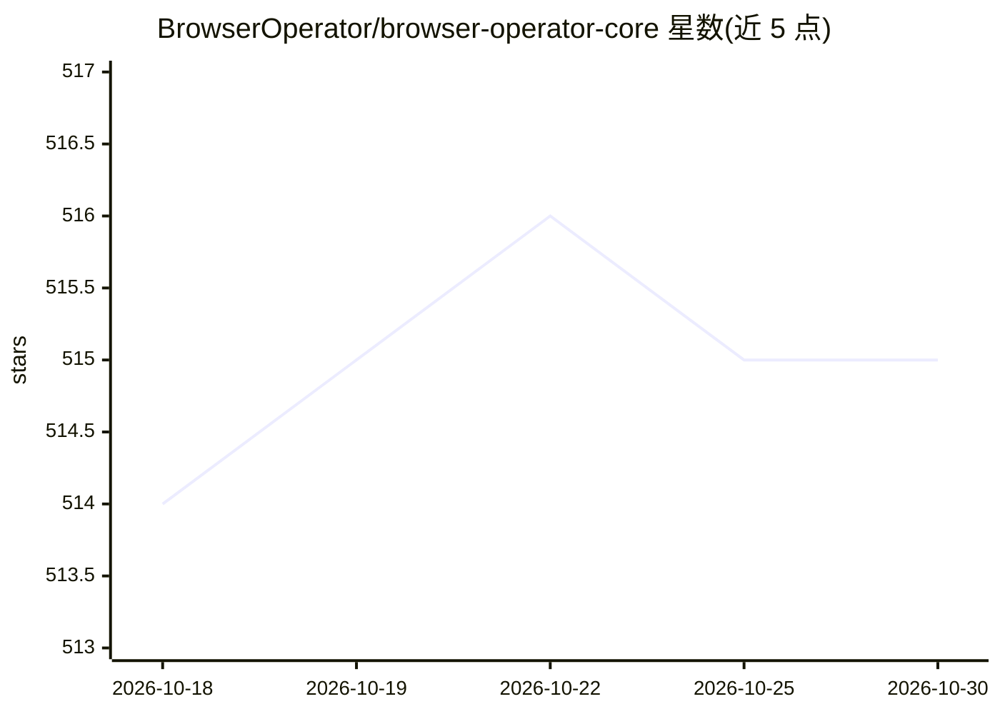

# BrowserOperator/browser-operator-core

⭐ 515 · TypeScript · BSD-3-Clause · 推送 2026-03-19 · [GitHub](https://github.com/BrowserOperator/browser-operator-core) · [官网](https://browseroperator.io/) · 组织维护

**开源 AI 浏览器：内置多 Agent 平台做网页研究与自动化**

面向普通用户的开源浏览器应用，内置多 Agent 协作平台，可执行文献调研、数据收集、比价追踪、商业自动化（人才搜寻、线索生成、合规审计）等网页任务。处理在本地进行，支持通过 OpenRouter/OpenAI/Groq 接入 400+ 云端模型，或经 LiteLLM 代理搭配 Ollama 使用本地模型实现完全离线。提供 macOS 与 Windows 安装包，需 macOS 10.15+ 或 Windows 10 (64-bit)+、8GB 内存。BSD-3-Clause 许可。

## 筛选速览

| 维度 | 判定 | 备注 |
|---|---|---|
| AI 角色 | `ai-native` | 本体是模型或模型工具 |
| 许可风险 | `permissive` | BSD-3-Clause |
| 部署形态 | `None` |  |
| 模型依赖 | local-ok | 支持本地模型 |
| 硬件要求 | — | 无带数字的原话,不猜 |
| 安装摩擦 | `low` | 无编译、无系统依赖或容器化 |
| 成熟度 | — | 结构信号不足 |

## 能力要点

- 多 Agent 协作自动处理复杂网页任务
- 本地处理，可搭配 Ollama 本地模型完全离线运行
- 通过 OpenRouter/LiteLLM 兼容 400+ AI 模型
- 提供 macOS 与 Windows 安装包

## 适用场景

- 让 AI agent 代我做文献综述与市场调研
- 自动比价、追踪商品价格与分析评论
- 自动化人才搜寻、线索生成等业务流程

## 场景标签

`浏览器自动化` `多智能体` `科研工具` · 领域:Agent 开发

## 证据(README 行号)

> L7: **Open-source, privacy-focused AI browser that transforms how you work on the web. An intelligent platform for resea
> L30: **Multi-Agent Automation** – Specialized AI agents work together to handle complex web tasks autonomously

## 星数曲线

2026-10-18 514 → 2026-10-30 515（+1）

---
*卡片 v1 · prompt 1.4 · 生成 2026-10-21 · 置信度 high · 依据 README sha `babdb95cd208` · [字段定义](../../DATASET.md)*
