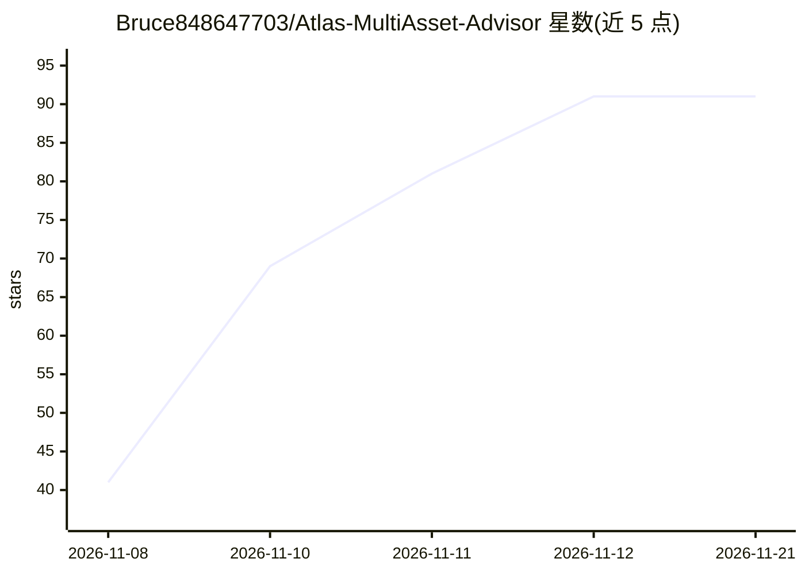

# Bruce848647703/Atlas-MultiAsset-Advisor

⭐ 91 · Python · Apache-2.0 · 推送 2026-11-20 · [GitHub](https://github.com/Bruce848647703/Atlas-MultiAsset-Advisor) · 个人维护 · 中文 README

**DeepSeek 驱动的多资产投资顾问 agent：画像、配置与因子进化**

面向个人投资者的多资产（股票/基金、债券、黄金、加密货币、期货）投顾 agent：量化核心完全确定性，DeepSeek 作为对话接口通过 22 个工具驱动核心，完成 C1–C5 适当性画像、资金分层约束下的配置、宏观/地缘/因子情报融合与家族办公室全球摆位。支持 Kairos 套件与 factor-forge 集成、因子库自进化、提示注入防护与工具调用预算。声明输出不构成持牌投资建议。以 Python 项目提供，含 Streamlit 仪表盘与 CLI。

## 筛选速览

| 维度 | 判定 | 备注 |
|---|---|---|
| AI 角色 | `ai-native` | 本体是模型或模型工具 |
| 许可风险 | `permissive` | Apache-2.0 |
| 部署形态 | `self-host` | docker 或自建部署 |
| 模型依赖 | locked-api |  |
| 硬件要求 | — | 无带数字的原话,不猜 |
| 安装摩擦 | `low` | 无编译、无系统依赖或容器化 |
| 成熟度 | — | 结构信号不足 |

## 能力要点

- 确定性量化核心 + DeepSeek 工具调用对话接口（22 个工具）
- 投资者适当性分层（C1–C5）与资金规模分层双重硬约束
- Kairos 套件可选集成：离线真实 ETF 数据、VaR/ES 风险叠加、106 策略排行
- LLM 安全边界：参数 schema 校验、工具调用预算、提示注入清洗

## 适用场景

- 通过对话完成风险测评并生成多资产配置方案
- 把券商研报因子导入因子库并做横截面验证
- 家族办公室视角的境内外资产摆位建议

## 场景标签

`金融量化` · 领域:学习与行业

## 证据(README 行号)

> L7: > A DeepSeek tool-calling agent for personal investing across **equities/funds,
> L8: > bonds, gold, crypto, and futures**. It profiles investor suitability (C1–C5)
> L41: Key principle: **the quant core is fully deterministic** (plans work with no LLM —

## 星数曲线

2026-11-08 41 → 2026-11-21 91（+50）

---
*卡片 v1 · prompt 1.4 · 生成 2026-11-17 · 置信度 mid · 依据 README sha `c52134c34c35` · [字段定义](../../DATASET.md)*
