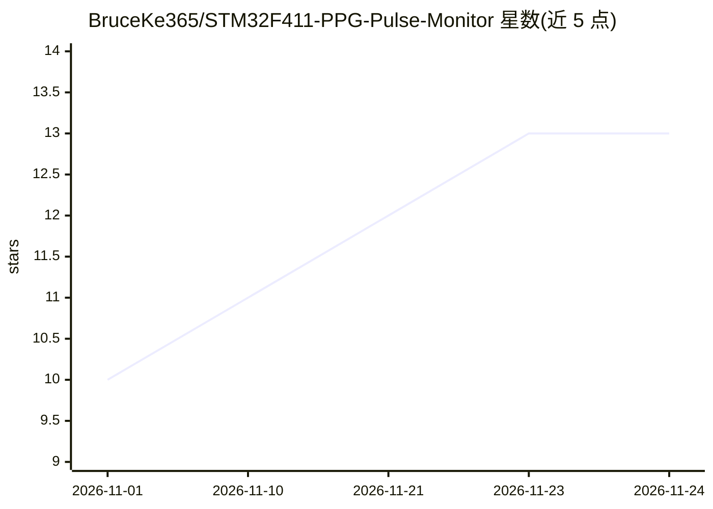

# BruceKe365/STM32F411-PPG-Pulse-Monitor

⭐ 13 · C · MIT · 推送 2026-10-08 · [GitHub](https://github.com/BruceKe365/STM32F411-PPG-Pulse-Monitor) · 个人维护 · 中文 README

**基于 STM32F411 与 MAX30102 的便携式心率血氧与房颤风险提示装置**

以 STM32F411CEU6 为核心的便携式脉搏测试仪课程设计项目：MAX30102 采集 PPG 信号后，在端侧完成质量控制、特征提取与轻量推理，输出心率、血氧、双 OLED 波形显示、朴素贝叶斯房颤风险提示与 Logistic Regression 压力指数。仓库包含固件源码、CubeMX/CMake 配置、PCB 工程与 Gerber 制板包、Python 采集/训练/验证脚本及数据集说明。需自行准备硬件、编译固件并烧录复现；明示非医学诊断工具。

## 筛选速览

| 维度 | 判定 | 备注 |
|---|---|---|
| AI 角色 | `ai-native` | 本体是模型或模型工具 |
| 许可风险 | `permissive` | MIT |
| 部署形态 | `desktop` | 安装包/桌面程序 |
| 模型依赖 | — | README 未给出锁定关系 |
| 硬件要求 | — | 无带数字的原话,不猜 |
| 安装摩擦 | `medium` | 含编译或系统依赖之一 |
| 成熟度 | — | 结构信号不足 |

## 能力要点

- 端侧 PPG 信号采集、质量门控与轻量推理（朴素贝叶斯 AF risk、Logistic Regression 压力指数）
- 提供 PCB 工程 .epro2 与 Gerber 制板包，可直接提交板厂制板
- Python 脚本支持串口采集、数据下载、模型训练与回放验证
- 面向 AI Agent 提供统一接手文档，整理当前状态与开发边界

## 适用场景

- 复现一套可实物运行、串口调试、屏幕展示的 STM32 脉搏测试仪
- 学习 PPG 信号处理与 MCU 端侧轻量推理的实现流程
- 使用附带的 Python 脚本做 PPG 数据采集与模型验证实验

## 场景标签

 · 领域:嵌入式硬件/健康监测

## 证据(README 行号)

> L20: - 房颤风险提示：从 PPG 峰间期 PPI 中提取 HRV/节律不规则特征，使用离散朴素贝叶斯模型输出 0-100% AF risk。
> L21: - 压力指数原型：从 PPI 序列提取 HRV 特征，使用标准化 Logistic Regression 模型输出 1-99 压力指数。
> L3: 本项目是基于 STM32F411 和 MAX30102 的便携式智能健康监测系统设计，实现了心率、血氧、OLED 显示、PPG 波形显示、房颤风险提示和 HRV 压力指数原型。

## 星数曲线

2026-11-01 10 → 2026-11-24 13（+3）

---
*卡片 v1 · prompt 1.4 · 生成 2026-11-19 · 置信度 mid · 依据 README sha `40aa7d8588e3` · [字段定义](../../DATASET.md)*
