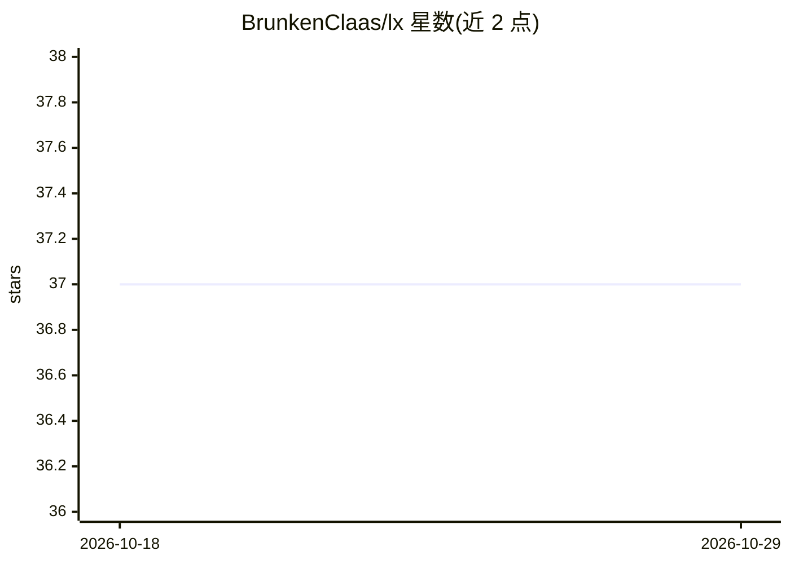

# BrunkenClaas/lx

⭐ 37 · Rust · Apache-2.0 · 推送 2026-08-14 · [GitHub](https://github.com/BrunkenClaas/lx) · 个人维护

**本地 LLM 驱动的 Unix 风格 CLI 工具套件（72 个）**

Rust 编写的命令行工具套件，把常见开发操作交给 LLM 完成：从 staged diff 生成提交信息（lxcommit）、自然语言转 shell 命令（lxsh）、按语义搜索日志（lxgrep）、日志分诊、diff 摘要、JWT 解码等 72 个可组合、可管道的小命令。默认使用本地 Ollama 模型（无需 API key），也可通过环境变量切换到 Anthropic、OpenAI、Gemini、Groq 等 10 家托管服务；本地模型建议 7-8B 以上、32k 上下文。提供 Linux/Windows 预编译二进制安装脚本，macOS 需从源码构建。

## 筛选速览

| 维度 | 判定 | 备注 |
|---|---|---|
| AI 角色 | `ai-native` | 本体是模型或模型工具 |
| 许可风险 | `permissive` | Apache-2.0 |
| 部署形态 | `desktop` | 安装包/桌面程序 |
| 模型依赖 | local-ok | 支持本地模型 |
| 硬件要求 | — | 无带数字的原话,不猜 |
| 安装摩擦 | `low` | 无编译、无系统依赖或容器化 |
| 成熟度 | — | 结构信号不足 |

## 能力要点

- 72 个可组合的 LLM CLI 工具，支持管道与 --json/--dry-run 输出
- 默认本地 Ollama 运行，无需 API key，冷启动 < 15 ms
- 支持 10 家托管模型服务切换（LX_PROVIDER 环境变量）
- 提供 bash/zsh/fish/PowerShell 快捷键集成（Ctrl+K 转命令、Ctrl+E 解释命令）

## 适用场景

- 让 git diff 自动生成提交信息
- 用自然语言描述需求直接得到 shell 命令
- 按语义而非字符串在日志中检索信息
- 在终端内离线使用 LLM 处理日常开发小任务

## 场景标签

`语义搜索` `代码生成` · 领域:编码与开发

## 证据(README 行号)

> L6: Write a commit message from your diff, turn plain English into a shell command,
> L8: terminal or pasting into a chat window. LX Coreutils is a suite of small,
> L21: git diff --staged | lxcommit               # write the commit message
> L23: lxgrep "failed logins" /var/log/auth.log   # grep by meaning, not by string

## 星数曲线

2026-10-18 37 → 2026-10-29 37（+0）

---
*卡片 v1 · prompt 1.4 · 生成 2026-10-25 · 置信度 mid · 依据 README sha `3355a01a3c3c` · [字段定义](../../DATASET.md)*
