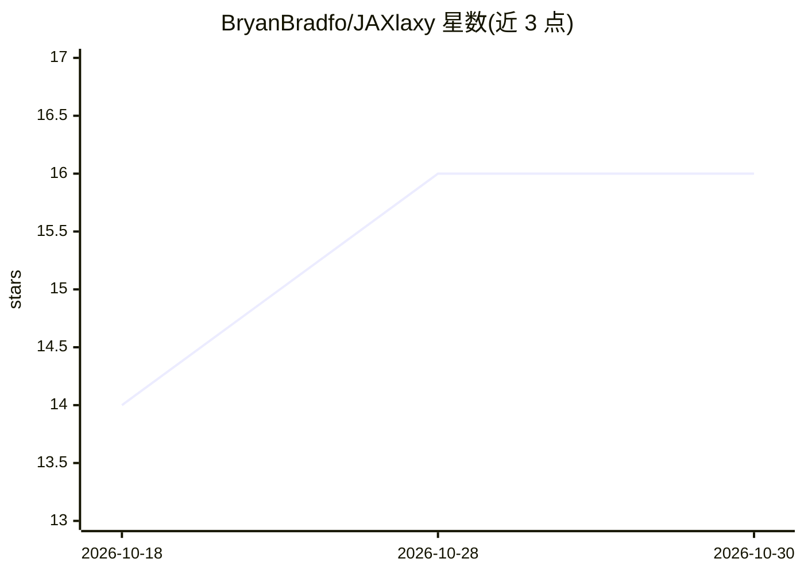

# BryanBradfo/JAXlaxy

⭐ 16 · TypeScript · Apache-2.0 · 推送 2026-10-26 · [GitHub](https://github.com/BryanBradfo/JAXlaxy) · [官网](https://jaxlaxy.bryanbradfo.me/) · 个人维护

**JAX 生态策展清单：按领域导航库与研究工具**

面向 JAX 生态的手工筛选索引，按主题组织条目：核心与内核、神经网络框架、训练基础设施、LLM/基础模型训练、科学计算与仿真（生命科学/物理/宇宙学/成像）、概率编程、强化学习与领域库。每条目带维护状态指示（Active/Stable/Legacy），并标注已被归档的项目及替代选择（如 Jraph、EvoJAX）。定位为 2020 年 JAX Ecosystem 帖子的更新版地图，声明收录截至 2026 年仍在维护的项目。

## 筛选速览

| 维度 | 判定 | 备注 |
|---|---|---|
| AI 角色 | `ai-knowledge` | 知识聚合/清单类 |
| 许可风险 | `permissive` | Apache-2.0 |
| 部署形态 | `None` |  |
| 模型依赖 | — | README 未给出锁定关系 |
| 硬件要求 | — | 无带数字的原话,不猜 |
| 安装摩擦 | `low` | 无编译、无系统依赖或容器化 |
| 成熟度 | — | 结构信号不足 |

## 能力要点

- 按主题分类组织 JAX 生态条目（框架/训练/LLM/科学计算/概率编程/RL 等）
- 每条目带 🟢/🟡/🔴 维护健康度指示
- 标注已归档项目（Jraph、EvoJAX）及替代方案

## 适用场景

- 为 JAX 项目选型时查找各领域的维护中库
- 了解 JAX 生态中哪些项目已停止维护及替代品
- 发现科学计算与强化学习方向的 JAX 工具

## 场景标签

`精选清单` · 领域:学习与行业

## 证据(README 行号)

> L12: **JAXlaxy** is a curated, opinionated, and constantly updated map of the **JAX** ecosystem.
> L16: Every entry has a **health indicator** — 🟢 Active · 🟡 Stable · 🔴 Legacy — so you can quickly see whether a library 

## 星数曲线

2026-10-18 14 → 2026-10-30 16（+2）

---
*卡片 v1 · prompt 1.4 · 生成 2026-10-30 · 置信度 mid · 依据 README sha `c9c34c916d34` · [字段定义](../../DATASET.md)*
