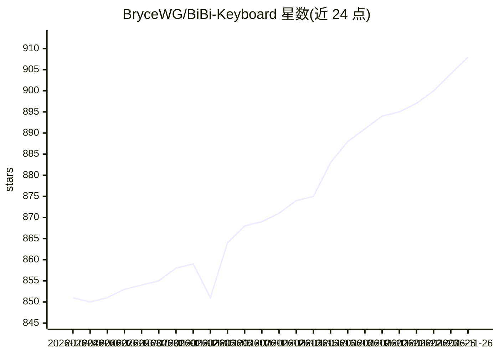

# BryceWG/BiBi-Keyboard

⭐ 908 · Kotlin · Apache-2.0 · 推送 2026-11-22 · [GitHub](https://github.com/BryceWG/BiBi-Keyboard) · [官网](https://bibi.brycewg.com) · 个人维护 · 中文 README

**安卓上的 LLM+ASR 语音输入法，长按麦克风即语音输入**

基于 Kotlin 与 Jetpack Compose 的 Android 语音输入法应用，长按麦克风录音后将语音识别结果上屏，并可用 LLM 润色识别文本。支持 18 个 ASR 供应商（12 云端 + 6 本地），内置 SenseVoice、Qwen3-ASR 等 6 种本地模型可离线识别，并提供主备引擎与本地兜底。附加悬浮球跨输入法语音输入、AI 编辑面板语音改文本、剪贴板同步、LSPosed 模块联动第三方输入法等能力。从 Releases 下载 APK 安装，需 Android 8.0+ 与麦克风权限；Pro 版为付费买断的独立上架版本。

## 筛选速览

| 维度 | 判定 | 备注 |
|---|---|---|
| AI 角色 | `ai-native` | 本体是模型或模型工具 |
| 许可风险 | `permissive` | Apache-2.0 |
| 部署形态 | `None` |  |
| 模型依赖 | — | README 未给出锁定关系 |
| 硬件要求 | — | 无带数字的原话,不猜 |
| 安装摩擦 | `low` | 无编译、无系统依赖或容器化 |
| 成熟度 | — | 结构信号不足 |

## 能力要点

- 18 个 ASR 供应商（12 云端 + 6 本地），含 6 种可离线的本地模型
- AI 文本润色修正识别结果，历史可缓存音频重跑
- 悬浮球在任意输入法场景语音输入，识别结果自动插入
- IME Bridge 通过 LSPosed/LSPatch 联动第三方输入法

## 适用场景

- 在安卓手机上用语音替代打字聊天
- 无网络时用本地模型离线识别语音
- 通过语音指令编辑和改写已有文本

## 场景标签

`语音识别` · 领域:感知与多模态

## 证据(README 行号)

> L5: **基于 AI 的智能语音输入法 | 让语音输入更自然、更高效**
> L36: - **多引擎支持** - 18 个 ASR 供应商（12 个云端 + 6 个本地）
> L37: - **本地 ASR 模型** - SenseVoice / FunASR Nano / Qwen3-ASR / Parakeet / FireRedASR / X-ASR，离线可用

## 星数曲线

2026-10-24 851 → 2026-11-26 908（+57）

---
*卡片 v1 · prompt 1.4 · 生成 2026-11-24 · 置信度 high · 依据 README sha `a4a59639fbe2` · [字段定义](../../DATASET.md)*
