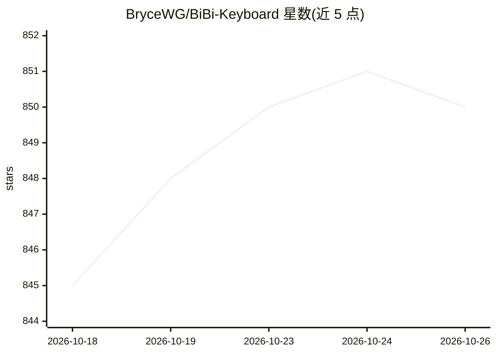

# BryceWG/BiBi-Keyboard

⭐ 850 · Kotlin · Apache-2.0 · 推送 2026-10-22 · [GitHub](https://github.com/BryceWG/BiBi-Keyboard) · [官网](https://bibi.brycewg.com) · 个人维护 · 中文 README

**Android 语音输入法：ASR 转文字，LLM 润色结果**

基于 Kotlin 的 Android 输入法应用，核心功能为语音输入：支持 18 个 ASR 供应商（12 云端 + 6 本地），本地模型包括 SenseVoice、FunASR Nano、Qwen3-ASR 等，可离线使用；识别结果可经 LLM 润色修正，支持主备引擎与本地兜底。另提供悬浮球跨输入法语音输入、AI 语音指令编辑面板、IME Bridge（经 LSPosed/LSPatch 与第三方输入法联动）、剪贴板同步等。面向普通用户，从 Releases 下载 APK 安装；另有付费 Pro 版上架 Play 商店，提供热词、简繁转换等附加功能。

## 筛选速览

| 维度 | 判定 | 备注 |
|---|---|---|
| AI 角色 | `ai-native` | 本体是模型或模型工具 |
| 许可风险 | `permissive` | Apache-2.0 |
| 部署形态 | `None` |  |
| 模型依赖 | — | README 未给出锁定关系 |
| 硬件要求 | — | 无带数字的原话,不猜 |
| 安装摩擦 | `low` | 无编译、无系统依赖或容器化 |
| 成熟度 | — | 结构信号不足 |

## 能力要点

- 18 个 ASR 供应商（12 云端 + 6 本地），本地模型离线可用
- LLM 润色识别结果，历史音频可缓存重跑
- 悬浮球跨输入法语音输入与自动插入
- IME Bridge 经 LSPosed/LSPatch 在第三方输入法中调用

## 适用场景

- 在任意输入框用语音代替打字输入文字
- 无网或网络不稳时用本地 ASR 模型离线语音输入
- 让 AI 润色修正语音识别结果后再上屏
- 在原有输入法中通过悬浮球或 IME Bridge 使用语音输入

## 场景标签

`语音识别` · 领域:感知与多模态

## 证据(README 行号)

> L36: - **多引擎支持** - 18 个 ASR 供应商（12 个云端 + 6 个本地）
> L39: - **AI 文本润色** - LLM 润色修正识别结果；历史可缓存音频并重跑识别或润色

## 星数曲线

2026-10-18 845 → 2026-10-26 850（+5）

---
*卡片 v1 · prompt 1.4 · 生成 2026-10-21 · 置信度 high · 依据 README sha `363391e23390` · [字段定义](../../DATASET.md)*
