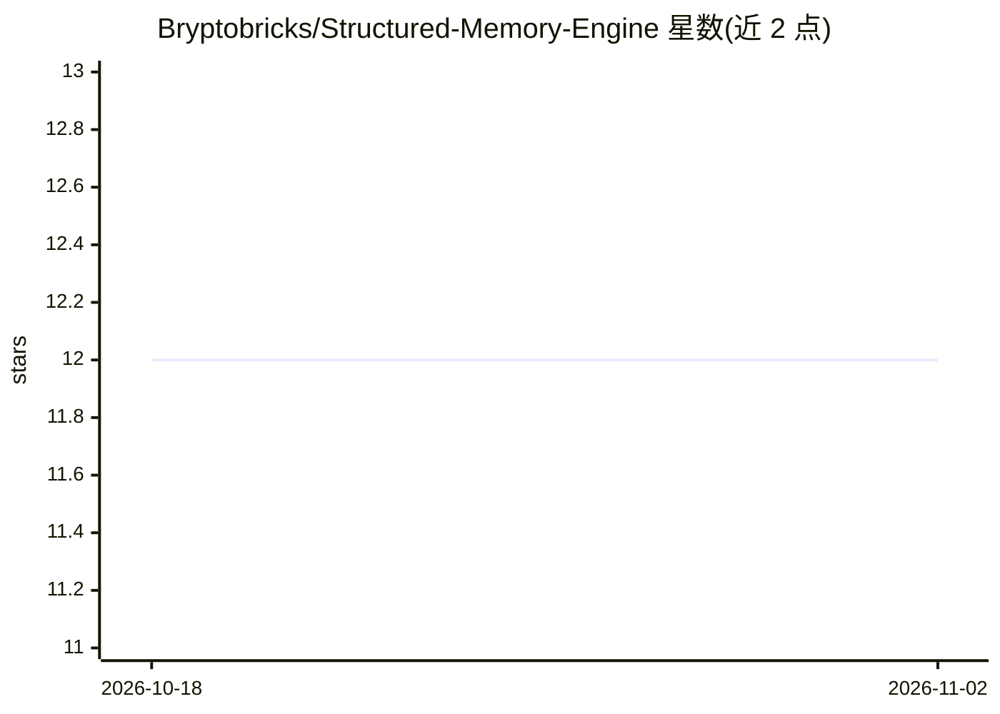

# Bryptobricks/Structured-Memory-Engine

⭐ 12 · JavaScript · MIT · 推送 2026-07-16 · [GitHub](https://github.com/Bryptobricks/Structured-Memory-Engine) · [官网](https://www.npmjs.com/package/structured-memory-engine) · 个人维护

**给 AI agent 的本地持久记忆引擎：索引 markdown 并自动召回上下文**

面向 AI agent 的记忆层：将工作区 markdown 文件索引为 SQLite FTS5 数据库，通过 6 步流水线（提取、实体扩展、双 FTS5 查询、6 信号排序、token 预算、注入）在每次 agent 回合前自动注入带引用与置信度的上下文。支持事实标签、矛盾检测、置信度衰减与自动捕获决策。全程本地运行，无需 API key。提供 npm 包、CLI、Node.js API、MCP 服务器（Claude Code/Cursor）与 OpenClaw 插件等接入方式；markdown 文件始终为唯一事实源，索引可重建。

## 筛选速览

| 维度 | 判定 | 备注 |
|---|---|---|
| AI 角色 | `ai-ecosystem` | LLM/agent 周边工具 |
| 许可风险 | `permissive` | MIT |
| 部署形态 | `library` | 以包/库形式分发 |
| 模型依赖 | — | README 未给出锁定关系 |
| 硬件要求 | — | 无带数字的原话,不猜 |
| 安装摩擦 | `low` | 无编译、无系统依赖或容器化 |
| 成熟度 | — | 结构信号不足 |

## 能力要点

- 6 信号排序 + 置信度衰减的检索流水线（作者实测 CIL 路径平均约 0.3ms）
- SQLite FTS5 + 本地 embedding，全程离线、无需 API key
- 提供 11 个工具的 MCP 服务器，支持 Claude Code/Cursor 接入
- 支持事实标签、矛盾检测与 CLI 冲突解决命令

## 适用场景

- 让 Claude Code/Cursor 在会话间保留项目决策与偏好记忆
- 把会议记录批量解析为可检索的结构化记忆
- 为自研 Node.js agent 注入带引用的自动召回上下文

## 场景标签

`Agent 记忆` · 领域:Agent 开发

## 证据(README 行号)

> L3:  Your AI agent forgets everything between sessions. SME fixes that.
> L51: |**Offline / Zero Cost**|SQLite FTS5 + local embeddings, no API calls|**$0/month forever.** No rate limits, no API 
> L82: Every time your agent receives a message, SME runs a 6-step pipeline in <50ms:

## 星数曲线

2026-10-18 12 → 2026-11-02 12（+0）

---
*卡片 v1 · prompt 1.4 · 生成 2026-11-01 · 置信度 high · 依据 README sha `1e13a1451d16` · [字段定义](../../DATASET.md)*
